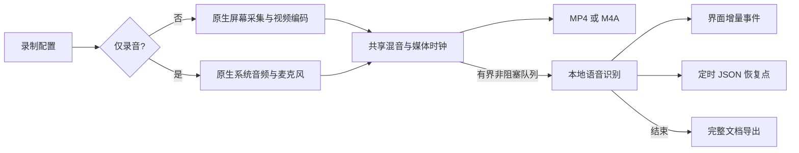
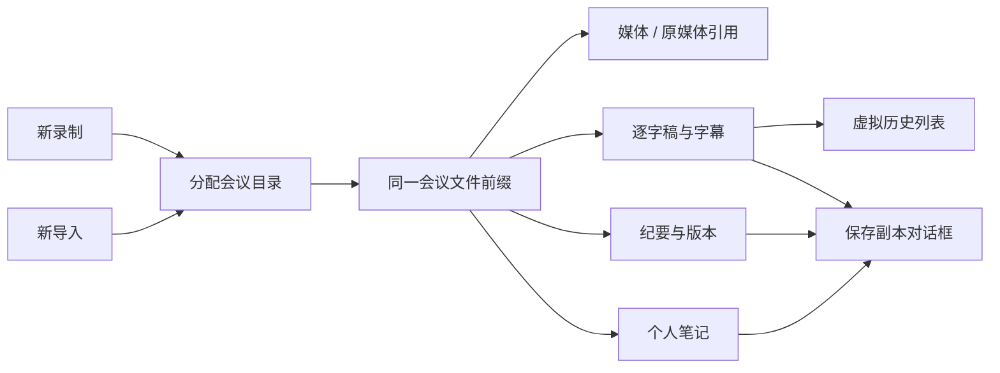
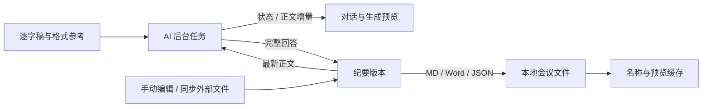

# 架构与实现约束

UI → RecordingSession 命令队列 → 录制工作线程 → 平台采集 → 帧策略/混音 → FFmpeg → fragmented MP4 → 无损 remux。Windows 使用 WGC/WASAPI，macOS 使用 ScreenCaptureKit/CoreAudio。

## 边界

`core` 不依赖 GPUI、FFmpeg 或平台 API。`CaptureBackend` / `AudioBackend` 管理原生后端生命周期；`VideoEncoder` 接受带时间戳的帧，返回零到多个 packet 并支持 flush。`Muxer
` 是后续分离输出容器的接口，当前 `MediaWriter` 直接管理视频与音频编码器及 MP4 输出。`RegionEditor` 位于 `core`，处理物理坐标中的编辑约束；macOS 原生选择器在 AppKit 点坐标中编辑，再转换为物理像素。后端初始化由 platform 的类型化函数负责。

平台 API 位于 platform。`CaptureTarget::Window` 保存 HWND（Windows）或 CGWindowID（macOS），启动时要求重新选择以避免 ID 复用。GPUI 的 AppKit 原始句柄是 NSView，不能直接作为 CGWindowID。当前 `VideoFrame` 是拥有所有权的 BGRA CPU 缓冲区，`Arc` 支持静态帧复用。未来 GPU 缓冲区应增加独立枚举/生命周期协议。Linux 后端未实现，仍显式编译失败。

macOS 的 Swift 桥接层通过 C ABI 接收配置和同步回调。屏幕采集与系统声音分别使用 SCStream，系统声音流只输出音频并采用 2×2 / 1 FPS 配置；麦克风使用 AVAudioEngine / AVAudioConverter。Rust 在回调返回前复制媒体数据。停止时关闭回调入口、停止流并排空队列，再释放 Rust 上下文，避免异步回调访问已释放指针。AppKit 菜单、区域选择及范围提示在主线程操作；会触发 GPUI 回调的窗口操作延后到下一轮主线程执行。

录屏权限以 ScreenCaptureKit 的实际结果判定。临时签名的 designated requirement 绑定当前二进制哈希，每次重建可能使旧授权失效；打包支持固定证书身份，默认临时签名仅用于本机评审。动态库递归捆绑并重写为应用内 rpath，独立应用不依赖 Homebrew 安装位置。

## 界面与录制反馈

窗口选择使用 DWM thumbnail，将源 HWND 合成到主窗口。GPUI prepaint 提供布局、DPI 和滚动裁剪边界，按可用宽度计算网格列数；默认完整展开，收起模式才启用列表滚动。映射目标矩形与源裁剪矩形；选择器关闭时隐藏并注销。不会为每个缩略图启动 WGC/FFmpeg。

macOS 14+ 的窗口列表使用 SCScreenshotManager 快照，macOS 13 仅显示窗口名称；每次刷新重建快照，不启动持续采集流。显示器尺寸采用 CGDisplayMode 的像素尺寸；窗口使用 SCContentFilter 的 pointPixelScale（macOS 13 根据主要相交显示器计算），区域 sourceRect 转换为点坐标，输出保持物理像素尺寸。

范围边框为独立分层工具窗口，设置 NOACTIVATE、TRANSPARENT 和 EXCLUDEFROMCAPTURE；区域/全屏范围未变时不重复刷新，窗口模式随源窗口边界更新，并在目标最小化、隐藏或 DWM cloaked 时隐藏。边框策略是常亮、启动短暂显示或关闭。WGC 初始化会请求 `Borderless` 权限移除系统捕获边框；失败时保留系统行为并上报警告。控制浮窗默认关闭，首次创建显式设置物理尺寸，避免绕过 GPUI 隐藏窗口的延后 placement 后显示为默认大窗口。主界面底部控制固定，内容独立滚动。

录制预览只消费将要送入编码器的帧：有界槽位缩小到最大 640×360，并限制发布到 5 FPS。它不会启动第二个 WGC 会话或编码器，关闭预览会立即释放该槽位的图像缓冲。

## 时间轴和队列

- 统一单调时钟，扣除暂停时间。平台原生时间转换为此时间轴；AudioTimeline 以 48 kHz 采样数串联回调，吸收短时回调抖动，暂停继续和真实中断时建立新起点。
- 试编码完成后才设定录制起点，不把探测时间录进视频。
- 采集队列最多两帧，队满驱逐旧帧。音频队列有固定容量，超出时告警并丢弃该包，后续采集继续；控制命令单独使用无界队列，停止命令不会被媒体积压丢弃。
- 策略对 80×45 亮度样本计算差异；保留最高帧率上限，静态时每秒保留帧，动态恢复。没有 OCR 或文本密度检测。
- MP4 使用 1/90000 视频时间基。延迟一包计算真实 sample duration，停止时补齐尾帧时长。B 帧关闭以降低延迟并简化实时时序。
- 音频统一为 48 kHz float stereo；混音按时间戳投放到有界时间窗口，缺失补零，迟到丢弃，输出限幅。起点之前的音频裁去对应采样，避免时间戳直接归零造成重叠。STFT 采用 sqrt-Hann、50% overlap-add，跨设备回调保留剩余采样，约 10.7 ms 延迟通过时间戳扣除，并在暂停、降噪切换和停止时排出尾部。系统声不经过麦克风降噪；两路静音告警独立统计。没有 AEC，使用扬声器时建议耳机。
- `SetAudio(AudioRouting)` 在录制线程应用，只有设备或开关改变的路会停止/重开，另一条路保留。混音缓冲按来源分开，切换清除该路未编码样本。GUI 预留 AAC 音轨支持初始全静音后开启，CLI 无音轨请求保持不变；切换记录保存在录制报告 `audio_changes`。
- 窗口尺寸变化时维持首帧输出尺寸，等比缩放留黑边。

## 失败和发布

开始失败会保留错误详情；录制中写入/编码错误保留 partial 文件。原生采集目标关闭、锁屏会走正常停止流程。恢复和普通输出均拒绝覆盖已有目标，原始恢复源保持不变。

FFmpeg ABI、GPUI 版本及 Rust 依赖由固定版本与 Cargo.lock 管理。发布构建必须使用同一套 FFmpeg DLL，禁止 `--enable-nonfree`。不承诺已有本机 FFmpeg 构建与打包 DLL 可互换。

## 后续优化接口

转录使用 `crates/asr` 的独立 CPU 工作线程。`MediaWriter` 在 AAC 编码前通过有界、非阻塞 PCM 观察队列发布混音，`RecordingSession::start_observed` 仅提供可选观察接口。ASR 不属于采集回调、编码器或 GPUI Render 生命周期。实时缺失区间从最终保存文件离线补转；字幕按 utterance id / revision 替换临时整句，只将最终段用于纪要。导入文件由 FFmpeg 增量解码并保持媒体时间戳。详见 `transcription-selection.md`。

应用 UI 已迁移至 GPUI Kit 0.7.3，由 Kit 固定 gpui-pre 0.3.9 并初始化 Root / theme / assets。Button、Input、Markdown 与滚动条复用 Kit 组件；原生窗口采集、句柄与录制线程保留平台边界。GPUI Fast 未启用。

GPU texture 生命周期与硬件编码器互操作、动态重配置、真实设备时钟平滑重采样、GPU 引擎利用率计数器，均须经过独立 Benchmark 后启用。Windows 优先尝试采集显示器所属厂商的编码器，macOS 优先尝试 VideoToolbox，失败后使用软件编码。端到端 GPU 零拷贝及 Linux PipeWire 后端尚未实现。

## 2026-10-12 会后说话人分析与可修订纪要

`asr::diarization` 复用本机解码和 sherpa-onnx，独立于实时识别任务，会后向 Transcript 写入说话人时间段。`asr::summary` 适配 Ollama / Responses / Chat Completions / Anthropic，完成分组整理、AI 问答、修订和版本持久化。`app::ai` 管理可见配置、系统凭据、后台状态和对话；录制模块不依赖 AI 服务。录制 / ASR / AI / 说话人分析任务串行调度，避免低资源机器同时加载推理任务；页面导航始终允许打开设置。

稿件、版本、来源和对话保留在本机；密钥进入 macOS 钥匙串或 Windows Credential Manager。远程请求仅由用户主动点击触发，转录文字发送到选定服务；音视频不发送。普通请求不阻塞 UI，Responses 可选服务端 background 轮询与取消。无需 Agent 即可完成标准结构 Markdown 和反复修改；原生 Word 模板渲染已实现，PDF 导出暂未实现。

### 默认服务与文档输出

默认 AI 为 DeepSeek 官方 Responses / deepseek-flash，Key 经操作系统凭据库持久保存。DeepSeek 不支持服务端 background，应用使用工作线程执行且主动携带稿件/对话上下文。`asr::document` 以 Markdown 为数据，通过 Rust docx-rs 写入 A4 DOCX，固定字体、标题层级、待办表格、续页表头及整行换页；无 Python 和模型生成脚本依赖。`MinutesHistory` 保存 Word/Markdown 历史版本与 AI 回合，提问只写回合，不重写文档。

### 会议结果工作区（2026-10-13）

`app/workspace.rs` 负责本地会议库发现、路径索引、逐字稿/纪要/笔记分区和笔记持久化；`app/shell.rs` 负责固定主导航、页头、公共通知和录制控制；`app/ui.rs` 提供统一主题和组件样式，录制与设置视图分别在 `recording.rs` / `settings.rs`。`app/transcription.rs` 负责转录及说话人任务与逐字稿展示；`app/ai.rs` 管理生成模板、对话和纪要导出。读取历史会议不会发起 AI 调用。界面分层和宽窄布局见 [界面重构设计](ui-redesign.md)。

`Transcript::save` 保留 JSON/Markdown/SRT，补充纯文本及最终原稿 Word。文档来源是确认的 ASR 文本而非 LLM。说话人索引由实际轮次生成，进入原稿；AI 默认只输出正文，选择包含来源后才附索引。标签不等于姓名，自动聚类数量需要核对。笔记单独保存，避免和 AI 对话或纪要互相覆盖。

### 任务计时、内容格式与推理预算（2026-10-13）

`app/task.rs` 管理单调时钟和根据实际进度计算的剩余时间；`app/ui.rs` 提供统一的 Progress 卡片，`app/shell.rs` 在文档内容上方组合任务状态。转录、说话人、AI 各自开始和结束计时，运行期间继续刷新耗时。只有 ASR 提供可测的整体进度；说话人原生接口和非流式模型请求使用阶段反馈与不定进度，不伪造总百分比。

`app/transcript_view.rs` 单独持有展示文本、标签缓存和可变高度 `ListState`；转录数据变化才更新缓存，普通滚动仅布局可见项和附近缓冲。行修订使对应高度缓存失效，直播使用尾随滚动、用户回看时暂停尾随。运行任务的秒表每秒通知，转录事件仍及时更新；文档 / 设置页停用录制预览生成。Windows `VideoFrame` 保留原生 row stride，后续编码、帧策略和缩略图继续按 stride 读行，去掉填充压缩的并行复制。详细证据与平台限制见 [性能排查](performance-review.md)。

`asr/worker.rs` / `diarization.rs` 保存转录、说话人处理耗时，`summary.rs` 保存每版纪要耗时。新增 JSON 字段可选且兼容旧文件。`Transcript::speaker_count` 计算实际不同标签数量，不以最大编号代替人数。说话人分割和声纹模型的线程数由同一个参数控制，默认 2，上限 4，并受本机可用线程数限制；保留既有分析窗口和模型精度。

`asr/minutes_format.rs` 负责格式配置、受限的本地正文读取和提示词边界，依赖已有 docx-rs 与 zip，不依赖 UI。它仅从 DOCX 的 `word/document.xml` 提取段落与表格文本，不加载图片、宏、外部关系或旧稿中的指令。支持最多 5 个示例，每个发送前 3000 字；显式要求优先，历史事实不能进入本场纪要。`app/ai.rs` 提供折叠的格式表单和原生多选文件框，配置保存为 `minutes-format.json`，读取正文在用户主动操作后的后台任务中完成。

来源预算按服务区分：DeepSeek 40000 字符，其他远程 20000，本机 Ollama 6000。预算内直接生成；长稿只逐段提取事实，再合并生成正文，避免每段重复生成完整纪要。DeepSeek 默认发送关闭思考的协议参数，用户可开启深度思考；其余服务保留各自协议。请求仍为非流式，首次可见 AI 文本须等待响应完成，因此阶段和耗时反馈是当前边界。

## 2026-10-17：仅录音、模型复用与实时路径隔离

现有 Rust / GPUI / FFmpeg 架构保持不变。用户对照测试确认关闭实时转录和预览后 Windows 卡顿明显改善，但尚不能把约三分钟周期归因到单一模块。

之前：所有录制必须先获得视频帧；实时文字硬性依赖 Streaming 和可选校正模型同时存在；每句提交都在持有输出路径锁时重新生成整份 JSON / TXT / Markdown / SRT，UI 每 200ms 设置输出路径会争用该锁。

改为：RecordingConfig.audio_only 在共享录制时钟、音频混音、暂停和恢复路径上分支，不创建视频采集或视频编码器，输出真正的 AAC/M4A。MediaWriter 将视频编码器设为可选，并显式记录音频流索引。音频恢复也必须实际解码验证。文件列表和崩溃恢复同时支持 M4A。

实时模型策略：优先已安装 Streaming；Offline 已安装时才启用可选校正。只有 Offline 时直接用 VAD 逐句识别，停顿或最长约 15 秒断句后出文字。两种模型都没有时明确说明缺少模型。启动录制不隐式下载。复用不意味着两种模型格式互换。

识别保存：先克隆输出路径再释放锁，文件 IO 不持锁；仅提交后以最多五秒一次频率保存 JSON 恢复点，结束时再生成所有格式。预览继续有界、限频，并仅在录制页可见时启用。录制中的二次校正仅在断句时执行，避免每 5/10/15/20 秒反复识别同一句；新配置默认关闭，已有选择保留。录制报告保留最近 1800 个一秒耗时/队列样本，无新增日志文件或上传。Windows 诊断采样延长到覆盖至少两个三分钟周期；没有 Windows 实机数据时不声称周期性卡顿已根治。

验证：旧配置兼容、模型四种安装组合、恢复点与完整导出、真实 AAC 音频唯一流/解码/时长/恢复拒绝覆盖、已有视频与暂停时间线回归。Mac 上不把 Windows 平台代码标为实机验证。

## 实时历史与会议目录（2026-10-17）

用户反馈 Windows 当前滚动已较流畅，本轮保留虚拟列表和原生渲染。修复范围：录制卡只显示最后一句、未完成转录只显示最近 40 段、导出按钮与打开按钮混淆、会议文件平铺难定位。

实时区与完整稿共用 TranscriptView：显示全部段落，只创建可见行；复用未变化文本，新增句追加、当前句只重测高度。Tail 跟随在向上滚动时暂停，回到底部或点击“回到最新”恢复。录制中文字固定在录制设置下方，开始录制不会搬动面板。结束不会打断正在阅读的历史位置。

新录制与新导入共用 core::create_meeting_base 原子分配会议目录，返回无扩展名的文件前缀，既有 with_extension 导出链路继续使用。文件名兼容 Windows，冲突创建新目录；导入只保存转录产物，原音视频留在原处，界面明确显示两个位置。历史平铺文件继续按原索引读取；不批量搬移。恢复扫描同时支持根目录和会议子目录，跳过符号链接。

导出副本通过系统保存对话框选择路径；自动保存仍在会议目录，打开文档是独立动作。保存根目录、当前会议目录、导入原文件目录分别命名，不把同一位置叫成“版本目录”。验证长实时稿早期内容可见、滚动锚点和尾随、会议目录碰撞和非法文件名、嵌套恢复及旧结构兼容、音视频保存与导出不覆盖源媒体。

## 会议文件与纪要对话工作区（2026-10-17）

本次沿用 Rust / GPUI、本地会议目录和系统凭据库。录制设置与实时文字的顺序固定，开始录制只改变状态，不搬动面板。

会议目录增加 `.meeting.json` 保存可修改的显示名称，媒体与转录路径保持稳定。列表读取现有转录、录制报告及媒体文件属性，缓存标题、正文预览、时长和体积；渲染不解码媒体。重命名只写元数据，导出采用会议名称。

AI 传输层将状态与正文增量分开，通过后台通道交给界面。普通请求使用真正 SSE（Ollama 使用 NDJSON）；后台 Responses 保留轮询。只有完整成功的回答才能生成纪要版本和 Word，断流、取消、错误保留原稿。正文与完整对话分别展示，输入改为多行，提问不修改正文。

未保存的手动草稿保存在 `.summary.draft.md`，切换会议或重启可恢复。手动编辑与外部 Word / Markdown 同步都通过同一版本保存入口，更新正文、Word 和历史文件；下一次 AI 修订以最新正文为基础。外部同步明确由用户触发，避免自动覆盖正在编辑的内容。修改请求保留用户明确补充或手动更正的事实，历史样式文件仍不提供本场事实。密钥增加已保存状态、载入按钮和内置显示开关，不写入配置文件。

实施顺序：固定录制布局；会议元数据与重命名；流式协议与失败验证；对话、编辑与文件同步；凭据显示；原生界面和工作区检查。无需数据库或新网络服务。

协议参考：[OpenAI SSE](https://developers.openai.com/api/docs/guides/streaming-responses)、[Claude 事件序列](https://platform.claude.com/docs/en/build-with-claude/streaming)、[Ollama Chat](https://docs.ollama.com/api/chat)。
