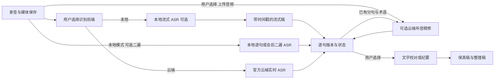

# 语音识别调研与改造方案

记录日期：2026-11-07。首批已加入本地逐句原稿/二遍稿、复核状态和耗时、录制进度与异常积压提示；云端识别、多模态精修、逐句自动补转和评测平台尚未实现。当前代码基线见 [当前技术方案](technical-current.md)，已有模型及限制见 [本地识别模型](asr-models.md)。用户已进一步明确：纯软件、本地优先、录制中尽量完成高质量识别，允许主动选择官方云端加速；与录屏资源调度的整合及分批交付见 [低功耗录屏建设方案](low-power-capture-plan.md)。

## 需求、范围与约束

- 在 Windows、macOS、Linux 保留本地优先，目标为边说边出字并在句末完成高质量复核；两遍模式由用户明确选择。会后补转用于文件导入和异常积压保全，不能代替录制中质量与速度的验收。
- 用户可以比较不同模型和处理方式；原音、识别原文和 AI 生成稿可区分、可恢复。不得悄悄覆盖用户编辑、历史纪要或源文件。
- 文件转录、实时二遍、文字校对和未来多模态听音校对分别记录来源、时间范围和任务状态。
- 可选云服务必须明确音频/文字传输范围和计费，以用户主动选择触发；本地模式不因网络或云凭据不可用而失效。
- 本阶段先评测与补齐已有两遍路径，再有条件地增加官方云服务；不先引入常驻 Python 服务、数据库或依赖逆向接口的默认功能。

## 调研结果和证据等级

| 信息 | 来源和可得结论 | 不能推断 |
| --- | --- | --- |
| 本地与云端 | 豆包输入法[隐私政策](https://lf3-cdn-tos.draftstatic.com/obj/ies-hotsoon-draft/wave_ime/ime_privacy_policy.html)描述可下载的本地语音资源，也描述智能模式的云端语音转写及文本优化。 | 不能因此断言所有设备都先在本地转写再传云端纠错。 |
| 多遍识别 | [free-asr 协议分析](https://github.com/nomoat/free-asr/blob/main/PROTOCOL.md)针对 macOS 版 1.0.2 描述实时/最终结果及多遍重评分；另有[安卓社区抓包片段](https://linux.do/t/topic/1569886?page=5)出现二遍、三遍参数，[社区对照](https://linux.do/t/topic/1569886)观察到最终文字更接近文件识别。 | 这些是第三方逆向和效果观察，不证明服务端模型名称、每一遍的具体计算或其他版本行为。 |
| 官方实时二遍 | [火山引擎流式接口](https://docs.volcengine.com/docs/doubao-voice/bidirectional-streaming-automatic-speech-recognition-websocket?lang=zh)可在实时结果后对已结束的句子音频再次识别；`enable_nonstream` 控制该能力。 | 该公开云 API 不足以证明输入法产品内部使用完全相同的端点或模型。 |
| ASR 内的大模型 | [Seed-ASR 论文](https://arxiv.org/abs/2407.04675)描述联合利用语音表示、上下文和语言模型进行识别。 | 论文不能用来确定每个线上版本的具体权重或性能。 |
| 音频 + 初稿精修 | [火山引擎 LAS 多模态精修文档](https://docs.volcengine.com/docs/lake-ai-service/speech-to-text-doubao-seed-2-0-lite-enhanced-version?lang=zh)支持原音频与已有分句一起提交给 Doubao-Seed-2.0-lite；也支持失败回退。 | 它是独立的云产品，不等于豆包输入法已经采用同一链路；实际效果、耗时和费用需对照。 |
| 开源实现 | [FunASR 的 2pass](https://github.com/modelscope/FunASR/blob/main/runtime/docs/SDK_tutorial_online.md)使用流式识别和句末非流式复核；[VoxType](https://github.com/melody0709/VoxType)提供 Windows 端多识别后端与回退参考。 | 不代表这些项目在本项目支持的所有硬件上开箱即用，也不应直接把未核实的模型授权视为可分发授权。 |

“离线”有两种含义：**本地离线**是不依赖网络；ASR 文档里的 **non-streaming/offline** 常指等到一整句或一段音频后再识别，也可以运行在云端。ASR 二遍仍要听音频，文字大模型校对只看到文字，多模态校对则可同时看到音频和初稿。

## 建议的目标流程

旧电脑优先保证媒体保存，同时以轻量流式 + 句末二遍实现用户选择的录制中高质量目标；分别测量首字延迟、句末定稿延迟与录制中复核覆盖率。若本机跟不上，应明确提示更快模型或用户已配置的云端服务。用户主动选择官方云端实时 ASR 时，用其流式/最终结果替代本地双模型主识别，避免重复计算；网络仍有开销，不能事先承诺不卡。LAS 文件精修仍为独立可选层。

## 实施里程碑

每阶段以可运行、可回退为目标；工时为相对量级，不是承诺日期。

1. **建立对照基线（小；无依赖）**：从经授权的真实会议中选取约 15–30 分钟代表性片段，覆盖普通话、方言、中英混说、远场、噪声、多人、人名和数字，人工整理参考稿；固定音频和文本规范化规则，记录字错率、英文词错误、人名/数字/否定词错误以及标点表现。音频默认留在本机，不自动上传。
2. **测资源与体验（小；依赖 1）**：在目标一代 i5 Windows Release 上分别比较仅录制、10/15/30 FPS、预览开关、实时 ASR 开关及现有单/双模型；记录设备、分辨率、编码器、CPU 单核/整机、内存、GPU 引擎、首字和最终延迟，并观察鼠标。先定义可重复场景和验收阈值，不能用当前合成样本推断真实收益。
3. **逐句版本数据（中；依赖 1）**：在 `crates/asr` 的现有 `Transcript` / `Segment` 上设计向后兼容的可选版本字段，保存流式初稿、二遍稿、模型与完成/跳过原因；保留原有顶层最终文字供旧数据和现有导出使用。旧 JSON 可读、未知可选字段可忽略；不伪造置信度或说话人。
4. **事件与竞态（中；依赖 3）**：在 `worker.rs` / `revision.rs` 沿用段 ID 和单调 revision，明确草稿、复核中、完成、回退四种事件；迟到回包不能覆盖较新版本或用户已确认的文本。暂停、取消、任务切换、空队列、重复事件均有确定的归属。
5. **控制录制负载（中；依赖 2、4）**：保持采集线程不等待 ASR。为二遍队列满、超过 30 秒等情况记录原因，支持录制结束后从已保存媒体补做；不额外保存无界 PCM。Windows、macOS、Linux 沿用各自平台线程与资源限制，不通过把帧率固定 10 就假定性能达标。
6. **分句上下文与术语（中；依赖 3）**：为模型实际支持的场景传入人名、术语和有限邻句上下文；热词是提示，不强制改写。无法编码的词单独提示；保留句首上下文和时间戳，不跨暂停边界混音。
7. **版本与进度界面（中；依赖 4、5）**：在 `crates/app` 显示“识别中 / 复核中 / 已复核 / 待补转”等真实状态，提供原稿与二遍稿对照、选用/恢复；用户编辑或确认后不被后台回包覆盖。只显示可测量进度，等待云端任务时显示状态和耗时，不编造百分比。
8. **可选云端 ASR（大；依赖 2、4、7）**：在 ASR 层增加明确配置的后端，优先使用供应商正式流式 API；真实区分草稿与定稿，网络失败可留本地稿重试。音频上传前向用户说明发送目的地和费用；凭据复用系统凭据库，避免写入普通配置或日志。未实现时本地路径不依赖任何云 SDK。
9. **可选听音精修（大；依赖 3、7、8 的凭据/任务基础）**：验证官方 LAS 是否适合项目，把原音频和 `asr_result.utterances` 映射为请求；其文档要求 1–9000 个非空单行分句、起止时间分别非递减、结束晚于开始且不超音频时长加 10 ms。将音频放到用户选定的 TOS 或可访问 URL；先验证格式、访问权限、URL 生命周期和隐私。异步保存任务 ID，区分 PENDING/RUNNING/COMPLETED/FAILED/TIMEOUT 与精修 SUCCESS/SKIPPED/FALLBACK，失败保留原稿；不要把跳过基础 ASR 等同于免费。
10. **AI 文字与听音结果分层（中；依赖 3、7、9）**：分别标记“识别原文”“听音复核”“AI 文字校对”“纪要/润色”，给出差异查看和恢复；日期、数字、人名、否定和未确定事项保留待核对标记。模型返回缺段、异常长度、时间错位或用户取消时不提交替换。
11. **验收与发布（中；依赖前述对应阶段）**：同一批真实样本做盲测；对旧电脑记录 CPU、鼠标体验和转录耗时，对 Windows/macOS/Linux 做构建和功能回归。新路线只在数据支持后推荐，不根据单个 TTS 样本宣称提升百分比。

## 取舍与配置

- 本地 Zipformer、SenseVoice、Paraformer 和现有 AI 服务继续复用；暂不将更大的 Qwen3-ASR 设为默认。[sherpa-onnx 模型说明](https://k2-fsa.github.io/sherpa/onnx/qwen3-asr/export.html)显示其量化文件仍较大，应先测旧电脑内存与速度。
- 复用现有 JSON、事件通道与 GPUI 视图；新接口按真实后端需求增加，不新建后台常驻服务。只有对比证明有收益，再考虑更复杂的自动切换或大模型常驻。
- 现有 `OPENCAP_MODEL_DIR` 控制本地模型缓存；云端凭据未来通过系统凭据库配置。当前无豆包云端配置字段；服务地址、计费及支持区域应以接入时官方文档为准。
- ASR：语音转文字；VAD：按语音/停顿分段；流式：边输入边更新；二遍：重用句子音频再次识别；CER：中文字错率；RTF：处理耗时与音频时长的比值。
