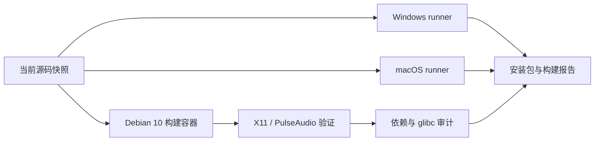

# 三端构建与 Linux 兼容

## 当前问题与实施边界

2026-10-17 检查最近 Actions：Windows 在 Clippy 参数转发失败；macOS 的真实录制测试使用固定睡眠加绝对时长上限，runner 调度延迟触发偶发失败。已有两条工作流没有上传可下载安装包。Linux 平台层目前是 compile_error，不能仅添加 runner 后宣称支持。

沿用 Rust / GPUI / FFmpeg。新增 Linux 平台模块，以 Deepin 常用的 X11 桌面、PulseAudio（或 PipeWire 的 PulseAudio 兼容服务）为首个实现范围；Wayland 屏幕采集需 portal + PipeWire，未实现时明确报错，音频和文稿仍可用。原生 X11 采集、窗口及区域选择、鼠标指针、快捷键和窗口图标分别封装；音频使用随包 FFmpeg/PulseAudio 输入，停止进程后排空管道，不阻塞录制队列。桌面托盘能力单独标记，不能因为存在快捷键就在没有托盘时隐藏关闭的主窗。

Linux 发布在 Debian 10 / glibc 2.28 基线上编译 FFmpeg 和应用，覆盖常见 UOS 20 的旧 glibc 环境；不替换系统 glibc。产物打包媒体、字体、窗口等非系统运行库，递归检查 ELF 依赖和 GLIBC 符号版本。CPU 架构必须匹配，x86_64、ARM64、龙芯不可混用；根据用户机器信息选择构建矩阵。

macOS 从现有绿色 / 红色图源生成多尺寸 ICNS，声明 CFBundleIconFile，在签名前放进 Resources，并给 Dock 设置运行状态图标。权限列表使用包的静态图标；不删除 TCC 记录或更改授权设置。固定包标识和路径。稳定权限身份仍需要可用的正式签名证书。

Actions 保留格式、测试、Clippy、Release 编译、运行依赖检查；新增各平台归档上传。远程构建用独立验证分支包含当前源代码，排除用户的音视频和 Word 文件，验证完成后再报告产物。发布源码和 FFmpeg 来源说明随包保存。

验证按依赖顺序：修复已知失败；Linux 编译及 Xvfb 合成采集、暂停、音频测试；Mac ICNS / plist / Dock 与签名检查；三端 Actions 跑完，下载运行库自检。构建成功不等于已在用户的 Deepin 硬件、GPU 驱动与所有显示协议上验证。

用户确认目标是 Intel x86 / 统信 UOS，因此 Linux Actions 首先交付 x86_64 的 .deb 与便携 tar.gz。FFmpeg 固定 9.0.2 并校验 SHA256；ONNX Runtime 所需的较新 C++ ABI 使用私有的 conda-forge GCC 12.2 libstdc++（固定包与哈希），同样经 ELF 审计，不覆盖宿主运行库。Linux 当前优先保证软件 H.264 / AAC 路径，硬件编码和真实 UOS 设备性能仍需另行验证。
