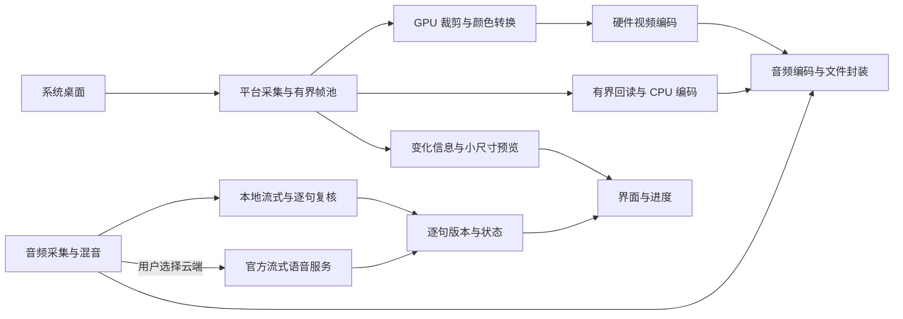

# 低功耗录屏与实时高质量识别建设方案

日期：2026-11-07。分析基线：`f8299c8` 及当前工作区。首批代码已加入事件驱动录制循环、CPU 图像缓冲复用、本地逐句复核状态，以及默认关闭的 Windows 非阻塞回读试验；Windows 新路径尚未实机验证。GPU 帧直通、云端语音和后续各平台硬件链路仍未实现。已有能力见 [当前技术方案](technical-current.md)，历史验证见 [性能排查](performance-review.md)。

## 1. 已确认的目标与判断

用户选择：**纯软件、不增加采集设备；本地优先；录制过程中尽量完成高质量识别；允许用户主动选择官方云端加速。** Windows 旧 i5 是首要验收设备，同时保持 macOS、Linux 的架构和功能边界。

成熟的软件路线是：系统把桌面交给 GPU 纹理，GPU 完成必要的裁剪、缩放和颜色转换，硬件视频单元压缩，CPU 接收压缩包并保存。微软的 [WGC](https://learn.microsoft.com/en-us/windows/apps/develop/media-authoring-processing/screen-capture)、[Desktop Duplication](https://learn.microsoft.com/en-us/windows/win32/direct3ddxgi/desktop-dup-api) 和 [OBS 的 WGC 实现](https://github.com/obsproject/obs-studio/blob/master/libobs-winrt/winrt-capture.cpp)提供了可参考的接口和代码。它接近“专用硬件处理画面”的思路，但仍消耗本机 GPU、内存、编码器和电力；本文所称减少回读，是减少全尺寸画面在 CPU 与 GPU 间往返，不承诺物理意义上的零拷贝或最低功耗。

**第一代 Core 没有 Intel Quick Sync。** Intel 的[代际对照](https://www.intel.com/content/www/us/en/developer/articles/guide/quick-reference-guide-to-2nd-generation-intel-core-processor-graphics-hd-graphics.html)列明该能力从第二代出现。实际电脑可能装有其他显卡，因此必须探测实际设备，不能根据“i5”或厂商名称断言存在硬件编码。没有合适硬件时，CPU 兼容路径的优化同样属于主任务。

目标按顺序验收：媒体完整与音画同步、桌面交互、录制中的最终识别质量和延迟、资源与能耗。CPU 占用下降不等于整机功耗下降，唤醒独显也可能增加耗电。Rust 能帮助控制所有权和分配，但同步 GPU 等待、内存搬运和模型计算仍需要单独优化。

## 2. 当前实现与需要改变的环节

| 环节 | 当前代码事实 | 建设方向 |
| --- | --- | --- |
| Windows 采集 | 原路径复用一个 staging 纹理并同步 `Map`；实验选项使用两个 staging 槽和非阻塞 `Map`，仍复制 CPU BGRA | 保留兼容路径；在目标机器验证非阻塞回读，再接 GPU 纹理路径 |
| Windows 设备 | `windows-capture` 2.0.1 的启动代码创建默认硬件 D3D 设备并要求 feature level 至少 11.0；项目另按显示器显卡厂商排序编码器 | 记录实际采集设备和编码设备的 LUID；厂商相同不能代替设备相同 |
| macOS 采集 | ScreenCaptureKit 输出 BGRA，Swift 锁定像素基址，Rust 在回调内复制为 CPU 帧 | 增加保留原生 CVPixelBuffer 的接口，减少全帧 CPU 访问 |
| Linux 采集 | X11 `get_image`，按 FPS 间隔抓取，CPU 合成鼠标；Wayland 尚未实现 | 优化现有 X11；Portal / PipeWire 作为后续独立后端 |
| 编码 | 包括硬件编码在内，目前都先用 CPU swscale 转换；可安全复用的输出缓冲已复用；低占用可选 H.264 优先 | 增加原生硬件帧输入和帧池；显式编码器选择不受 H.264 优先选项影响 |
| 帧策略与预览 | 运动检测读取 CPU 80×45 样本；预览最高约 3 FPS、640×360，已有单槽背压 | GPU 模式用变化元数据或微小缩略图判断；预览只读回缩小后的图像 |
| 工作循环 | 录制工作线程按事件和截止时间唤醒；视频编码、音频处理与封装仍共用线程 | 接硬件路径时隔离视频编码等待与音频封装 |
| ASR | 流式与文件识别都已使用单线程 CPU；二遍最多两句等待、另有一项执行；逐句保存原稿、复核状态及耗时，超载保留流式稿 | 对照实际设备测量准确率和实时性，继续完善负载调度与补转 |

以 1920×1080 BGRA 为例，一帧约 8.3 MB；30 FPS 的一次完整复制约 249 MB/s，10 FPS 仍约 83 MB/s。这只是数据量计算，不是占用实测。现有 10 FPS 按钮同时关闭预览和实时转录，无法用于单独证明帧率收益，也不符合用户本次选择的实时高质量目标。

采样必须区分 CPU 提交耗时与 GPU 实际完成时间：`CopyResource` 调用很快不代表 GPU 复制很快。GPU 时间戳只在受支持时异步读取，不能为了采样新增同步等待；所有阶段计数和分布有界，避免每帧写日志。

## 3. 目标结构与职责



GPU 编码和 CPU 编码按能力选择；本地和云端识别按用户选择运行，不默认同时执行两套完整识别。录制音频保存不等待识别。新建的编码工作线程只输出压缩包，封装线程独占文件输出上下文，继续使用现有时间轴和 fragmented MP4 / 恢复机制。

模块归属（以下新模块只在对应里程碑创建）：

```text
crates/core/          帧元信息、配置、报告字段；保留 CPU VideoFrame
crates/platform/      CapturedFrame、原生资源包装、能力探测和采集会话
  windows_impl/       回读队列、原生 WGC 会话与 D3D11 资源
  native/macos.swift  CVPixelBuffer 保留/释放及变化信息的 C ABI
crates/policy/        编码候选、基于变化信息的帧决策
crates/media/         视频工作线程、硬件帧适配、音频和封装、缩略预览
crates/asr/           逐句复核状态、来源版本及可选云端后端
crates/app/           用户可理解的资源选项、字幕状态和任务进度
scripts/              可重复的采样、对照和打包验证
```

### 接口与依赖边界

- 保留 `core::VideoFrame` 和已有 CPU 编码接口；在 `core` 增加不含原生句柄的 `FrameMeta`，包含尺寸、采集时间、内容版本及变化信息是否可信。采集时间与输出 PTS 分开，避免缓存画面重用时丢失原始帧龄。
- 在 `platform` 增加 `CapturedFrame`，包含元信息和 CPU 帧 / Windows 自有纹理 / macOS 像素缓冲的受控包装。原生类型仅在对应平台编译；不让 `core` 依赖 FFmpeg 或平台 SDK，不用无约束的裸指针加 `unsafe Send/Sync` 掩盖生命周期问题。
- `media` 内部增加 `VideoPipeline`，统一接收 `CapturedFrame`，输出编码参数、压缩包、统计和错误；复用现有 CPU 编码器。编码器与实际设备、像素格式成对协商，不能在 CPU 适配器里暗中把 GPU 帧完整下载来伪装成功。
- `policy` 接收变化信息；元数据缺失时可使用 GPU 生成的 80×45 亮度图，异步读取。采样未准备好时保守处理变化，不能把旧样本当作静止。不会为了沿用旧 `FramePolicy` 而每帧读取完整画面。
- 保留现有 JSON 字段，新配置和报告字段具有默认值；增加实际处理路径、设备标识、格式、回读字节数和原因分类。现有 `capture_fps` 的含义不改，新计数区分系统回调、限速跳过、完成回读、排队和编码。

### 资源与时间轴规则

- CPU 回读池使用两个槽位，CPU 待编码队列继续最多两帧。GPU 外部帧池使用 `max(3, 编码器要求的外部表面数)` 个槽位，最多八个，按实际尺寸和格式限制项目中间图像总预算为 128 MiB；超出则报告并回退兼容路径。编码器内部的额外分配另记可观测的内存，不能把该预算冒称为整个进程内存上限。
- 槽位状态为可用、GPU 操作中、待编码、编码器持有；只有完成并释放引用后才能重用。池满时可丢弃尚未提交的旧帧或拒绝新帧，不能覆盖 GPU / 编码器仍使用的资源。
- 编码包通道固定最多 32 个包，满时只向视频工作线程施加背压，上游可跳过尚未编码的原始帧。不能丢弃已经编码的参考帧包，音频和封装线程也不等待视频队列清空。
- Windows immediate context 的使用统一串行化；FFmpeg 互操作的锁遵循其 [D3D11 硬件上下文约定](https://raw.githubusercontent.com/FFmpeg/FFmpeg/n8.0.1/libavutil/hwcontext_d3d11va.h)。避免跨线程持锁等待 GPU，不从采集回调借出会被帧池重新写入的纹理。
- 媒体工作线程等待控制命令、音视频事件及下一个必要截止时间；暂停或静止时减少唤醒，收到新画面即唤醒。断开的接收通道应注销，避免 `select` 在断开通道上空转。
- 继续扣除暂停时间、保持音频时钟、单调视频 PTS、静态尾帧和输出时长。停止时有界排空，设备错误时保存已完成内容。录制中不往同一 MP4 轨道随意切换编码器/编码参数；初始化阶段可回退，运行中致命错误则安全保存并提示重启录制。

## 4. 平台路线与能力选择

**Windows：WGC 为首条建设路线。** 平台层新增一个受控原生 WGC 会话：`FrameArrived` 只写单槽唤醒信号，专用采集线程取帧并拥有 D3D 资源与回读队列；原有 `windows-capture` 路径作为回退。先使用两个 CPU 可读 staging 槽位，先处理已完成的旧复制，再提交新复制；用 `D3D11_MAP_FLAG_DO_NOT_WAIT`，繁忙状态保留待处理槽位并退出本轮，不能立即阻塞重试。存在待回读资源时最多每 5 ms 检查一次，没有待处理资源时等待事件；停止时有界排空，避免尾帧永远等不到下一次回调。微软 [Map 说明](https://learn.microsoft.com/en-us/windows/win32/api/d3d11/nf-d3d11-id3d11devicecontext-map)定义了繁忙与设备移除等返回值。

该新会话复用现有目标、边框、鼠标和关闭策略，也用于后续 GPU 模式。当前 `windows-capture` 启动入口没有注入自选设备的接口，因此需在这层控制实际设备，按显示器及纹理设备的 LUID 协商，使用同一设备上的 GPU 裁剪 / NV12 转换，交给匹配的 QSV、NVENC 或 AMF 硬件帧适配器。先跑 H.264 垂直样例，再分别开放经验证的厂商与其他编码；使用项目实际打包的 FFmpeg 功能探测，不能照搬最新版文档假定所有版本都支持。

新增“低占用”策略时 H.264 优先，成功探测结果在当前进程缓存，键包含设备、驱动、FFmpeg 版本、尺寸、格式和编码配置，真实初始化失败后失效；不在每次开始时依次试完多种 AV1 / HEVC 编码器。用户显式指定编码器时沿用其选择并报告失败。默认避免为了编码而跨卡搬运或唤醒另一块独显，是否更省电由对照验证。

Desktop Duplication 是全屏/区域录制的后续备选，可用其 dirty / move / cursor 元数据减少重复工作，但不能直接替代窗口采集：屏幕裁剪会包含遮挡物，行为与独立窗口捕获不同。先保留 WGC，只有对照证明有收益后再以显式选项开放该后端；不把换 API 本身当作性能结论。

**macOS：ScreenCaptureKit → CVPixelBuffer → VideoToolbox。** 增加拥有引用计数的像素缓冲桥接，优先测试系统输出 NV12、保留色彩信息、通过 FFmpeg VideoToolbox 硬件帧输入，输出仍由现有媒体层封装。[FFmpeg 8.0.1 实现](https://raw.githubusercontent.com/FFmpeg/FFmpeg/n8.0.1/libavcodec/videotoolboxenc.c)可接收 `AV_PIX_FMT_VIDEOTOOLBOX`，不必另造一套文件输出。屏幕尺寸变化时由系统或 GPU 适配固定输出尺寸；验证裁剪、黑边、色彩和像素缓冲释放。纯视频路径不锁定全尺寸 CPU 基址，界面预览只读取缩小后的图像；失败回到现有 BGRA 路径。

**Linux：先完成现有 X11 的低开销版本。** 优先测量获取图像、鼠标混合、转换和编码，再以能力探测加入 XShm；保持不支持共享内存时的兼容采集。Wayland 后续使用 [ScreenCast Portal](https://flatpak.github.io/xdg-desktop-portal/docs/doc-org.freedesktop.portal.ScreenCast.html) 协商 PipeWire 流，再按实际格式判断是否可接硬件缓冲；不把 X11 或 Xvfb 的通过当作 Wayland 验证。该后端不阻挡 Windows 首批可试版。

GPU 路径初期为显式试验选项，兼容路径保持可选。每个平台和设备组合通过完整测试后，才纳入“自动”选择；未验证组合不能默认标为省电或零回读。

## 5. 录制中的高质量识别与体验

**默认产品方向是边录边识别、句末复核。** 复用现有轻量 Zipformer 实时稿和用户选定的 SenseVoice / Paraformer 二遍；新“实时高质量”选项明确开启二遍，并保留用户原有模型设置。较大模型只有在代表性录音上证明质量与实时性适合后才推荐，不能单凭体积判断准确率。

当前单线程解码、有界队列、模型实例复用已经存在。新增工作是：记录首字/句末最终延迟、模型运行 RTF、等待时长和跳过原因；保存流式初稿、二遍稿及来源；区分“实时稿 / 复核中 / 已复核 / 待补转”。修订沿用段 ID 和 revision，迟到结果不能覆盖较新的用户编辑；文字 AI 校对和听音复核有不同标记。

录制中本地流式和二遍各最多一个执行任务，二遍最多两句等待。资源控制发生在句子之间，不能假设能安全抢占正在执行的原生模型。保持原音保存和实时稿，优先在停顿时处理待执行的复核；超过容量的句子记录时间范围，完成录制后可补转。这是异常负载下的保全措施，不能用大量延后复核宣称达成录制中高质量。若该设备持续 RTF 大于 1，应明确提示当前模型跟不上，并让用户选择更快的模型或云端。

用户已允许提供可选云端加速，但这不授权自动上传实际会议音频。未来用户主动切换到官方云端实时 ASR 后，用该服务的流式结果和句末定稿替代本地双模型主识别，减少重复计算；未选择云端时始终本地运行。网络中断保留已确认文字和原音，可启动本地后备，明确标出中断区间；不无限缓存 PCM 或自动重复计费。优先复用[官方流式二遍接口](https://docs.volcengine.com/docs/doubao-voice/bidirectional-streaming-automatic-speech-recognition-websocket?lang=zh)，LAS 文件精修仍属于独立的可选处理。模型和证据边界详见 [语音识别方案](asr-improvement-plan.md)。

界面复用现有 GPUI 虚拟列表：新结果到达时更新对应句段，耗时每秒刷新，隐藏页不生成预览。录制中展示“已处理至 / 落后录音多少秒”和复核状态，不给尚未结束的会议计算虚假的总百分比。文件转录才按音频时长显示进度；模型准备、识别、复核、保存分阶段显示，估时只在进度真实前进时出现。诊断详情可展示实际设备和处理路径，日常界面使用“硬件加速 / 兼容模式”等可理解的说明。

## 6. 实施顺序与可交付版本

工作量 S / M / L 为相对规模，不是完成日期。每批可独立回退；首批不等待全部 GPU 平台完成。

| 编号 | 交付内容 | 依赖 | 工作量 |
| --- | --- | --- | --- |
| 1 | 固定 1080p 静态文档、窗口移动、持续变化和标准音频场景；建立旧 i5 / Mac 基线 | 无 | S |
| 2 | 平台阶段计数、耗时分布、回读字节、实际设备与 ASR 延迟写入有界报告；首批已有计数和最大值，分布、编码设备 LUID 及首字延迟待补 | 1 | M |
| 3 | 用事件与截止时间替换 5 ms 轮询；验证暂停、断开通道、静态尾帧、音频和停止 | 2 | M |
| 4 | Windows 受控 WGC 会话与双槽非阻塞回读，保留原兼容开关和有界排空 | 2 | L |
| 5 | 低占用 H.264 候选与探测缓存；优化 CPU 编码图像复用，编码器持有的缓冲不得提前改写 | 2 | M |
| 6 | 实时高质量选项、逐句版本/复核状态与延迟；异常积压提示 | 2 | M |
| A | **首批可试版：已集成 3–6；macOS 本地 Release 可测试，Windows 平台层已交叉编译，Windows 完整打包和实机验收待完成** | 3–6 | M |
| 7 | 增加原生帧接口；视频编码工作线程与音频封装隔离 | A | L |
| 8 | Windows 同设备 WGC → GPU 转换 → H.264 硬件帧垂直样例及厂商适配 | 7 | L |
| 9 | macOS 原生像素缓冲 → FFmpeg VideoToolbox，补 GPU 变化采样和小预览 | 7 | L |
| B | **硬件加速试验版：按通过验证的平台/设备开放 GPU 路径** | 8 或 9 | M |
| 10 | 可选官方云端流式识别、主动配置/上传说明、断线与版本归属 | 6 | L |
| 11 | X11 共享内存优化；另立 Wayland Portal / PipeWire 验收 | A | M / L |
| 12 | 目标机器对照、能耗和质量复核，更新推荐配置、文档入包清单与打包记录 | A；B/10/11 各自完成后复测 | M |

CPU 路径先优化而保留，GPU 帧封装只在实际硬件功能接入时引入；不更换 UI 框架、不新增常驻 Python 服务或内核驱动。Desktop Duplication 与 Wayland 后端为独立后续批次，不扩入首批试验范围。

## 7. 验证、验收与安装

以下为**目标和验收方法，尚无本次新实现的一代 i5 Windows 实机验收结果**；本机合成编码测试和自动化验证的范围见 [性能排查](performance-review.md)。

- **基础对照**：同设备、分辨率、屏幕内容、编码格式和音频，先固定关闭 ASR / 预览比较旧版、新兼容版和 GPU 版，再逐项开启；分别测试 30 / 15 / 10 FPS，不能只比较两个多项设置不同的按钮结果。每场景 11 分钟、至少三次，覆盖用户周期性卡顿；另做至少 30 分钟长录制。
- **交互与资源**：记录 OpenCap / DWM 的 CPU、各 GPU 引擎、队列和阶段 P95/P99、内存、唤醒次数。保持原测试设置，新版不能靠持续少录帧换低占用。硬件路径关闭预览时，全尺寸 CPU 回读字节应为 0；开启预览时只允许缩略图级读回。兼容路径对比原版的阻塞时间和鼠标体验；旧 i5 未实测前不宣称问题已消除。
- **功耗**：条件允许时使用同一主机的外部功率计测每分钟耗电，固定亮度、电源模式、后台程序和温度状态。只有 CPU / GPU 利用率时称为“资源占用对照”，不能称整机最低功耗。初始工程目标是同等功能下有可重复的占用下降且功耗不回退，不预报固定提升百分比。
- **媒体正确性**：可解码、无新增音频丢包、暂停/恢复/窗口尺寸变化正确，30 分钟音画时长差目标不超过 100 ms；测试竖屏、多显示器、裁剪、鼠标、色彩、静态尾帧、设备丢失和恢复文件。GPU 纹理在编码器消费完成前不被复用，无持续内存增长。
- **识别目标**：用同一批经授权会议建立人工参考，比较 CER、人名、数字、否定词和最终覆盖率；目标为最终稿准确率不低于当前所选高质量文件模型。录制中高质量模式的初始体验目标为首字 P95 ≤1 秒、句末最终稿 P95 ≤2 秒（从断句时点计）、≥95% 句子在录制过程中完成复核。以上指标需在目标设备实测；失败则明确标为该模型/设备组合不满足实时目标，推荐更快模型或用户已配置的云端，不能隐藏未完成项。
- **边界与自动化**：对回读/资源槽状态、繁忙返回、停止排空、旧 JSON、任务取消、用户编辑与迟到回包编写针对性测试；运行工作区测试、严格 Clippy 和各平台 Release 构建。Windows 交叉编译只证明可编译，不代替旧显卡、驱动和真实鼠标验证；云端用模拟结果和主动授权样本验证。

按用户要求更新本机默认 `release/OpenCap.app` 时，打包脚本在可执行文件未运行的前提下保留旧包备份，构建、递归捆绑依赖、签名校验后再替换默认路径。Mac 包用于本机测试，Windows 测试包需在 Windows 构建，不能沿用旧 ZIP 冒充新版本。

## 8. 参考与术语

- WGC：Windows Graphics Capture，提供窗口/显示器的 D3D 画面；DXGI：Windows 图形基础接口；LUID：标识当前系统中的实际显卡适配器。
- staging / Map：GPU 图像的 CPU 可读中间资源及映射；PTS：输出媒体时间戳；NV12：常见 8 位双平面 YUV 格式。
- CVPixelBuffer / VideoToolbox：Apple 原生图像缓冲与视频编码；CPU / GPU 帧池均需按生命周期复用。
- RTF：识别耗时与对应音频时长之比；CER：中文字错率；P95/P99：95% / 99% 样本不超过的值。
- 方案保留 Rust / GPUI / FFmpeg / sherpa-onnx；各版本与本地模型说明见 [当前方案](technical-current.md) 和 [模型文档](asr-models.md)。新增能力均需匹配实际打包库，原用户配置默认保留；云端凭据继续使用系统凭据库。

额外技术参考：[Apple ScreenCaptureKit 示例讲解](https://developer.apple.com/videos/play/wwdc2022/10155/)、[Apple 帧变化区域](https://developer.apple.com/documentation/screencapturekit/scstreamframeinfo/dirtyrects)、[FFmpeg 编码器与设备支持](https://ffmpeg.org/ffmpeg-codecs.html)、[windows-capture 上游](https://github.com/NiiightmareXD/windows-capture)。
