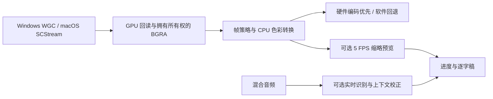

# 录制与长稿性能排查

## 已确认的路径与边界

Windows 反馈为进程约 9% CPU、桌面鼠标严重卡顿；本轮没有远程连接那台 Windows，不能仅用平均 CPU 判定正常，也不能确认具体驱动或 GPU 是否饱和。CPU 是整机平均值，单核、GPU Copy/3D/Video Encode、桌面合成和短时竞争需要分别观察。当前录制报告记录最终 CPU 样本及编码器，不代表全程平均。

用户日志中的旧 `dev.sh` 成功启动裸 Debug 程序，工作区只设置 `debug=0`，没有优化级别，故仍为 opt-level 0。旧版两条打包命令调用同一个 packager，只打包已有 Release 二进制。新版 packager 默认先编译；macOS 的 `dev.sh run` 也先构建并打包，再启动同一路径的原生应用包。SIGINT 表示中断；字体重复和依赖未来兼容性警告不是启动失败。

硬件编码没有消除 GPU 到 CPU 的回读和 BGRA 转换。原生分辨率为 2560×1600 时，单次 BGRA 数据量约 16.4 MB；30 FPS 仅一次全帧拷贝就约 492 MB/s。此为数据量计算，不是实测带宽或 CPU 占用。默认实时转录与上下文校正也有独立 CPU/内存成本，不能和仅收发压缩视频的会议软件直接等同。

## 修改前后评审

| Before | After | Why |
| --- | --- | --- |
| 完整逐字稿建立所有句段，滚动仍布局全稿、重复计算说话人标签 | 独立逐字稿视图，缓存标签和文本，使用可变高度虚拟列表 | 布局工作随可见内容增长，长句保持自然换行 |
| 每 200 ms 后台任务整页通知；隐藏的录制页仍可能生成预览 | 计时按显示的秒数刷新；文档页不消费录制预览 | 减少与滚动竞争的重绘和图像上传 |
| Windows 去填充调用依赖的按行并行拷贝，再复制完整帧 | 保留合法 stride，一次连续拷贝拥有数据 | 去掉一次内存搬运和全核线程池唤醒 |
| WGC 不请求系统更新间隔，仅在回调中丢帧 | 支持时请求对应 FPS 的系统间隔，保留回调限速 | 尽量在采集源头降低更新频率，兼容旧 Windows |
| 打包可能复制旧二进制 | 默认先编译所选 profile；显式 no-build 才只打包 | 避免源码修改和实际运行包不一致 |
| 裸 Debug、应用包、测试启动器混用，打包覆盖运行中的包 | macOS 开发启动走原生包；拒绝覆盖运行中的应用 | 授权身份与运行进程一致，不让旧进程继续使用新版签名 |

## 验证与限制

先验证虚拟列表的长短稿、临时整句替换、长句换行、滚动后恢复、切换会议；运行既有音视频时间轴检查，确保 stride 修改不影响编码内容。最终执行全工作区测试、严格 Clippy、普通 Release 构建与签名。

Windows 需要在同一机器、相同画面/分辨率/帧率下，分别采集应用关闭、仅打开、纯录制、录制加 ASR、关闭预览、最小化的 CPU/GPU 数据，并读取录制报告的实际编码器。GPU 零拷贝、替换 UI 框架和关闭转录默认值不在此轮未经测量的改动范围。

Windows 内存去填充的并行拷贝只发生在原生 row pitch 大于紧凑行宽时；对齐的整屏宽度可能原本就没有这次拷贝。因此不能把这个修复认作所有 Windows 卡顿的根因。GPUI Windows Debug 在调试层可用时启用 DirectX 调试验证，并使用未优化着色器；正常 Release 不启用它。

5000 句合成长稿在真实 GPUI Debug 窗口中运行程序化滚动：1200 / 620 宽度，开头、四分之一、中间和末尾每次只请求 4–12 个不同句段布局。此为布局规模检查，不是 FPS 基准。原生滚轮检查长句换行、移动到后续段落、切换 AI 后返回保持逐字稿位置。

## macOS 授权调查

本机系统设置的 OpenCap 录屏开关原为开启。TCC 日志记录 `Failed to match existing code requirement`，麦克风旧要求含 cdhash `1c04ac…`，多次新构建 / 测试签名不同；临时 UI 启动器还使包入口成为 shell。这解释了“开关开启但旧授权不匹配”，不能把它归因为 Debug 不支持录屏。

界面测试结束后恢复原生 Mach-O，删除启动器和 opencap.bin，普通 Release 完整签名验证通过。通过系统设置仅移除 / 重新添加当前 OpenCap 的屏幕授权，并选择 Quit & Reopen；实际录制页随后枚举到 3360×2100 显示器，不再显示录屏授权错误。其他应用的权限未改动，未改写 TCC 数据库或放宽代码签名要求。本机没有有效代码签名证书，临时签名在二进制 / 包内容改变后仍可能需要重新授权；Debug 和 Release 都如此。此轮没有另行录制用户桌面或声音，也没有确认新版 Windows 实机性能。

Windows 可在相应场景设置好后运行 `scripts/diagnose-windows.ps1 -Scenario idle` 等命令。它仅采样 OpenCap / DWM CPU、内存、线程与系统 GPU 各引擎计数，并可读取指定录制报告的编码器 / 分辨率 / 设置；无上传、无第三方依赖。GPU 计数不可相加当作整卡百分比。PowerShell 语法检查通过，Windows 实机采样尚未执行。

## 2026-10-17：实时路径、仅录音与周期性卡顿

用户对照结果：同时关闭实时转录、画面预览后，Windows 周期性鼠标卡顿明显改善。这缩小了排查范围，尚不能区分这两项各自贡献，也不能据此认定 WGC 或驱动没有问题。源码未发现固定 180 秒周期任务；当前没有 Windows 实机，所以不声明根治。

确认并修复：实时 ASR 在持有 UI 共用输出路径锁时保存整份 JSON / TXT / Markdown / SRT，UI 每 200ms 反复设置同一路径可能等待文件 IO；现在先释放锁，最多五秒一次只写 JSON 恢复点，完整导出延后到结束。Word 原本仅完整转录时生成，并非录制中每句生成。UI 只在路径变化时更新；模型可用性缓存到页面进入、下载完成和启动录制时，渲染不扫描磁盘。

录制中的 SenseVoice 二次校正原来每 5 秒重复识别当前最长约 20 秒音频；现在只在断句后执行，保留即时流式假设和最终校正。新配置默认关闭二次校正，用户已有选择保留。仅安装文件模型时用 VAD 逐句实时识别；Streaming 单独安装也能启动，不再把可选校正缺失判为完全不可用。

新增 audio_only 分支共用音频、时钟、暂停和恢复机制，不调用视频采集 / 编码器，直接 AAC/M4A。macOS 系统声仍用 ScreenCaptureKit 的音频输出，需要系统音频权限；麦克风单独使用无需屏幕枚举。进入录制页不再提前枚举屏幕。锁屏时仍沿用原先停止录制的行为。

录制报告增加最近 1800 个一秒样本：CPU / 内存峰值 / FPS / 丢帧 / 音视频及转录队列 / 录制循环、编码、预览、音频写入峰值耗时。内嵌原报告，无新增后台服务或日志文件。耗时仅针对录制工作线程，不能替代 UI、鼠标延迟和 Windows 驱动分析。PowerShell 采样默认 660 秒，增加 CPU / GPU 驱动信息，覆盖三分钟现象多轮；未在 Windows 采样运行。

| Before | After | Why |
| --- | --- | --- |
| 录制模式只有屏幕、窗口、区域 | 同一排加入“仅录音”，隐藏画面和画质项，主按钮为“开始录音” | 声音操作位置稳定，不需寻找或选择屏幕 |
| 文件模型已下载但显示缺少实时模型 | 分别显示模型安装状态，并复用文件模型逐句出字 | 提示真实能力，避免重复下载 |
| 开关藏在设置中 | 录制页实时文字卡可直接切换转录和断句校正 | 录制前能明确选择资源开销，无新增动画 |

采集链路参考：[Microsoft WGC 文档](https://learn.microsoft.com/en-us/windows/uwp/audio-video-camera/screen-capture)。本项目仍把 GPU 帧读回 CPU，转换后交给编码器；硬件编码不等于全程零拷贝，不是外接采集卡。
