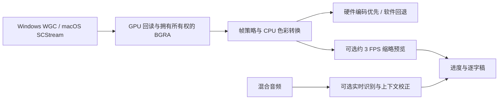

# 录制与长稿性能排查

## 已确认的路径与边界

Windows 反馈为进程约 9% CPU、桌面鼠标严重卡顿；本轮没有远程连接那台 Windows，不能仅用平均 CPU 判定正常，也不能确认具体驱动或 GPU 是否饱和。CPU 是整机平均值，单核、GPU Copy/3D/Video Encode、桌面合成和短时竞争需要分别观察。当前录制报告记录最终 CPU 样本及编码器，不代表全程平均。

用户日志中的旧 `dev.sh` 成功启动裸 Debug 程序，工作区只设置 `debug=0`，没有优化级别，故仍为 opt-level 0。旧版两条打包命令调用同一个 packager，只打包已有 Release 二进制。新版 packager 默认先编译；macOS 的 `dev.sh run` 也先构建并打包，再启动同一路径的原生应用包。SIGINT 表示中断；字体重复和依赖未来兼容性警告不是启动失败。



硬件编码没有消除 GPU 到 CPU 的回读和 BGRA 转换。原生分辨率为 2560×1600 时，单次 BGRA 数据量约 16.4 MB；30 FPS 仅一次全帧拷贝就约 492 MB/s。此为数据量计算，不是实测带宽或 CPU 占用。默认实时转录与上下文校正也有独立 CPU/内存成本，不能和仅收发压缩视频的会议软件直接等同。

## 修改前后评审

| Before | After | Why |
| --- | --- | --- |
| 完整逐字稿建立所有句段，滚动仍布局全稿、重复计算说话人标签 | 独立逐字稿视图，缓存标签和文本，使用可变高度虚拟列表 | 布局工作随可见内容增长，长句保持自然换行 |
| 每 200 ms 后台任务整页通知；隐藏的录制页仍可能生成预览 | 计时按显示的秒数刷新；文档页不消费录制预览 | 减少与滚动竞争的重绘和图像上传 |
| Windows 去填充调用依赖的按行并行拷贝，再复制完整帧 | 保留合法 stride，一次连续拷贝拥有数据 | 去掉一次内存搬运和全核线程池唤醒 |
| WGC 不请求系统更新间隔，仅在回调中丢帧 | 支持时请求对应 FPS 的系统间隔，保留回调限速 | 尽量在采集源头降低更新频率，兼容旧 Windows |
| 打包可能复制旧二进制 | 默认先编译所选 profile；显式 no-build 才只打包 | 避免源码修改和实际运行包不一致 |
| 裸 Debug、应用包、测试启动器混用，打包覆盖运行中的包 | macOS 开发启动走原生包；拒绝覆盖运行中的应用 | 授权身份与运行进程一致，不让旧进程继续使用新版签名 |

## 验证与限制

先验证虚拟列表的长短稿、临时整句替换、长句换行、滚动后恢复、切换会议；运行既有音视频时间轴检查，确保 stride 修改不影响编码内容。最终执行全工作区测试、严格 Clippy、普通 Release 构建与签名。

Windows 需要在同一机器、相同画面/分辨率/帧率下，分别采集应用关闭、仅打开、纯录制、录制加 ASR、关闭预览、最小化的 CPU/GPU 数据，并读取录制报告的实际编码器。GPU 零拷贝、替换 UI 框架和关闭转录默认值不在此轮未经测量的改动范围。

Windows 内存去填充的并行拷贝只发生在原生 row pitch 大于紧凑行宽时；对齐的整屏宽度可能原本就没有这次拷贝。因此不能把这个修复认作所有 Windows 卡顿的根因。GPUI Windows Debug 在调试层可用时启用 DirectX 调试验证，并使用未优化着色器；正常 Release 不启用它。

5000 句合成长稿在真实 GPUI Debug 窗口中运行程序化滚动：1200 / 620 宽度，开头、四分之一、中间和末尾每次只请求 4–12 个不同句段布局。此为布局规模检查，不是 FPS 基准。原生滚轮检查长句换行、移动到后续段落、切换 AI 后返回保持逐字稿位置。

## macOS 授权调查

本机系统设置的 OpenCap 录屏开关原为开启。TCC 日志记录 `Failed to match existing code requirement`，麦克风旧要求含 cdhash `1c04ac…`，多次新构建 / 测试签名不同；临时 UI 启动器还使包入口成为 shell。这解释了“开关开启但旧授权不匹配”，不能把它归因为 Debug 不支持录屏。

界面测试结束后恢复原生 Mach-O，删除启动器和 opencap.bin，普通 Release 完整签名验证通过。通过系统设置仅移除 / 重新添加当前 OpenCap 的屏幕授权，并选择 Quit & Reopen；实际录制页随后枚举到 3360×2100 显示器，不再显示录屏授权错误。其他应用的权限未改动，未改写 TCC 数据库或放宽代码签名要求。本机没有有效代码签名证书，临时签名在二进制 / 包内容改变后仍可能需要重新授权；Debug 和 Release 都如此。此轮没有另行录制用户桌面或声音，也没有确认新版 Windows 实机性能。

Windows 可在相应场景设置好后运行 `scripts/diagnose-windows.ps1 -Scenario idle` 等命令。它仅采样 OpenCap / DWM CPU、内存、线程与系统 GPU 各引擎计数，并可读取指定录制报告的编码器 / 分辨率 / 设置；无上传、无第三方依赖。GPU 计数不可相加当作整卡百分比。PowerShell 语法检查通过，Windows 实机采样尚未执行。

## 2026-10-17：实时路径、仅录音与周期性卡顿

用户对照结果：同时关闭实时转录、画面预览后，Windows 周期性鼠标卡顿明显改善。这缩小了排查范围，尚不能区分这两项各自贡献，也不能据此认定 WGC 或驱动没有问题。源码未发现固定 180 秒周期任务；当前没有 Windows 实机，所以不声明根治。

确认并修复：实时 ASR 在持有 UI 共用输出路径锁时保存整份 JSON / TXT / Markdown / SRT，UI 每 200ms 反复设置同一路径可能等待文件 IO；现在先释放锁，最多五秒一次只写 JSON 恢复点，完整导出延后到结束。Word 原本仅完整转录时生成，并非录制中每句生成。UI 只在路径变化时更新；模型可用性缓存到页面进入、下载完成和启动录制时，渲染不扫描磁盘。

录制中的 SenseVoice 二次校正原来每 5 秒重复识别当前最长约 20 秒音频；现在只在断句后执行，保留即时流式假设和最终校正。新配置默认关闭二次校正，用户已有选择保留。仅安装文件模型时用 VAD 逐句实时识别；Streaming 单独安装也能启动，不再把可选校正缺失判为完全不可用。

新增 audio_only 分支共用音频、时钟、暂停和恢复机制，不调用视频采集 / 编码器，直接 AAC/M4A。macOS 系统声仍用 ScreenCaptureKit 的音频输出，需要系统音频权限；麦克风单独使用无需屏幕枚举。进入录制页不再提前枚举屏幕。锁屏时仍沿用原先停止录制的行为。

录制报告增加最近 1800 个一秒样本：CPU / 内存峰值 / FPS / 丢帧 / 音视频及转录队列 / 录制循环、编码、预览、音频写入峰值耗时。内嵌原报告，无新增后台服务或日志文件。耗时仅针对录制工作线程，不能替代 UI、鼠标延迟和 Windows 驱动分析。PowerShell 采样默认 660 秒，增加 CPU / GPU 驱动信息，覆盖三分钟现象多轮；未在 Windows 采样运行。

| Before | After | Why |
| --- | --- | --- |
| 录制模式只有屏幕、窗口、区域 | 同一排加入“仅录音”，隐藏画面和画质项，主按钮为“开始录音” | 声音操作位置稳定，不需寻找或选择屏幕 |
| 文件模型已下载但显示缺少实时模型 | 分别显示模型安装状态，并复用文件模型逐句出字 | 提示真实能力，避免重复下载 |
| 开关藏在设置中 | 录制页实时文字卡可直接切换转录和断句校正 | 录制前能明确选择资源开销，无新增动画 |

采集链路参考：[Microsoft WGC 文档](https://learn.microsoft.com/en-us/windows/uwp/audio-video-camera/screen-capture)。本项目仍把 GPU 帧读回 CPU，转换后交给编码器；硬件编码不等于全程零拷贝，不是外接采集卡。

## 本轮：旧设备录制负载

- Windows WGC 和 macOS ScreenCaptureKit 的采集帧带有 16 字节有效填充，色彩转换可直接读取已有 BGRA 数据，避免编码前再复制整帧；Linux X11 和不带填充的外部帧仍走原有复制路径，避免为每个 X11 采集帧额外重新分配。填充遵循 [FFmpeg 对 swscale 平面越界读取的说明](https://ffmpeg.org/doxygen/6.0/structAVFrame.html)。硬件编码仍需采集回读和 CPU 转换，不能据此声称 GPU 零拷贝。
- Windows 复用 D3D11 CPU 暂存纹理，只在尺寸或格式变化时重建；整屏与区域分别使用资源复制和区域复制，成功映射后始终解映射。回读仍是同步的，是否减少鼠标卡顿需要真实显卡和驱动验证。
- 固定帧率不再分析运动，同一个缓存帧也不再每 5 毫秒重新取样；预览限至约 3 FPS、复用横向坐标，界面尚未消费时不重复生成。
- 录制页新增“一键降低占用”，显式把最大采集帧率限制为不超过 10 FPS、打开自适应、关闭预览和实时转录，并启用更快的 H.264/H.265 软件编码。录制偏好提供软件编码速度开关，既有配置保持原样。低帧率和快速编码会影响流畅度、体积或质量，详细提示直接显示在按钮旁。
- 录制报告区分完成回读的 `capture_fps` 与送入编码器的 `fps`；前者由已接收帧加队列挤掉的帧估算，相邻采样可能有至多两帧的队列偏差。排查时仍需在同一台机器、同一分辨率和画面下比较实时转录、预览及低占用设置。
- 重复上报相同进度不再重置“最后更新”时间；停滞超过 15 秒时不继续显示过时的剩余时间，新阶段进度倒退时重新计算。
- 参考视频编码改用 FFmpeg 封装库的帧时长接口，兼容旧版 `pkt_duration` 和新版 `duration` 字段；旧版解封装可能把静态尾帧误报为普通帧时长，恢复时依据视频流时长保留无重排视频的尾帧。打包版本仍沿用项目约定的 FFmpeg。

上述变化是针对已确认的代码开销，不能证明老款 Windows 电脑的鼠标卡顿已经消除；需在该设备上使用 Release 版本，对比原设置和低占用设置，并查看 CPU、GPU 引擎及录制报告。WGC 和显卡驱动兼容性也需实机验证。

本机 macOS ARM、FFmpeg 8.0.1 做了交替运行的 Release 合成基准：1920×1080、20 秒合成 PPT、固定 30 FPS、libx264，三个旧版耗时分别为 16.063 / 3.069 / 3.029 秒，三个新版为 9.052 / 2.870 / 2.782 秒；中位数为 3.069 → 2.870 秒，约快 6.5%。两组均编码 600 帧。首次结果波动很大，因此这里只用于发现明显回退；场景不包含真实屏幕采集、预览、实时识别或鼠标事件，不能推断旧 Windows 机器的占用或交互改善幅度。

Linux ARM64 的 Debian 容器使用 FFmpeg 5 完成媒体单元测试及时间轴测试；Xvfb 800×600、无音频、10 FPS 上限的短录制正常保存，静止后编码帧率约 1 FPS，报告中的采集帧率约 9–11 FPS（包括相邻秒的队列偏差）。这是虚拟桌面正确性检查，不是 UOS 或旧显卡的性能测试。Windows 平台层仅交叉编译和 Clippy 检查，尚未在 Windows 实机验证。

## 10 FPS 是否能解决旧 Windows 电脑卡顿

**不能保证。** Windows 回调在纹理映射、回读和后续处理之前按设定间隔丢弃多余帧；在系统支持时也向 WGC 请求较长的采集更新间隔。支持与否由运行时判断，不能假定老系统具备该能力。即便限制生效，处理的每一帧仍需同步 GPU 回读、内存复制、色彩转换和编码，还会与桌面合成、驱动及其他工作竞争；平均 CPU 低也可能有单核或短时阻塞。自适应会进一步减少静态画面的编码帧，但不等于采集源始终只触发那么多回调。10 FPS 录制的运动画面也比 30 FPS 不流畅。

确认旧电脑的 Windows 版本和显卡驱动也很重要：[WGC 的桌面窗口采集接口](https://learn.microsoft.com/en-us/windows/win32/api/windows.graphics.capture.interop/nf-windows-graphics-capture-interop-igraphicscaptureiteminterop-createforwindow)最低要求 Windows 10 1903，这不等于整个应用在该版本及其驱动上已经验证通过；Windows 7 / 8 不具备这条 WGC 路径。

“一键降低占用”还会关闭预览及实时转录、启用自适应和更快的软件编码；整体改善不能直接归因于 10 FPS。录制报告中的 `capture_fps` 估算应用收到及队列挤掉的帧，不是 WGC 原始回调次数，也不能衡量鼠标响应。

在同一台目标电脑上使用 **Release 版**、相同显示器、分辨率、窗口、屏幕内容及编码器做对照；先固定关闭实时转录、断句校正和预览、固定自适应设置，再分别录制 30 / 15 / 10 FPS。随后固定选中的 FPS，每次只打开预览或实时转录中的一项，另测仅录音与应用未运行的基线。如需评估“一键降低占用”，将它作为额外组合对照，不要与单一帧率变化混为一谈。静态文档与持续窗口移动各测一组；每轮至少超过三分钟，针对周期性问题建议 11 分钟：

```powershell
./scripts/diagnose-windows.ps1 -Scenario recording -Seconds 660
```

每轮记录设置与编码器、录制报告中的 `capture_fps` / `fps` / 队列丢帧和耗时、采样到的 OpenCap / DWM CPU、各 GPU 引擎、内存及鼠标拖动和指针是否卡顿。采样为两秒一次，可能漏掉短尖峰；CPU 是整机归一化值，GPU 各引擎不能直接相加。若 10 FPS 仍卡，优先定位同步回读 / 色彩转换和驱动占用，再决定是否进行异步回读或 GPU 编码链路改造；若关转录或预览后改善，则分别针对相应路径优化。报告和对照方案不包含任何实测承诺。

## 本轮实现和实测方法

录制循环已改为等待音视频、命令和定时事件；CPU 转换图像在编码器允许复用时复用，低占用设置增加自动 H.264 优先和软件探测结果缓存。本机合成编码测试只适合发现明显回退，不代表实际桌面或旧 i5 的结果。Windows 新增默认关闭的「异步采集（实验）」：两个有界暂存槽使用非阻塞 Map；初始化失败回退原采集，运行时致命错误结束录制并保留已完成内容。它仍会回读完整画面到 CPU，不是 GPU 纹理直通。

2026-11-07 本机 macOS ARM、FFmpeg 8.0.1 合成 PPT 对照，均为 1920×1080、固定 30 FPS、20 秒、libx264 `veryfast`、600 帧：旧代码一次 3.370 秒，新代码两次 3.623 / 3.478 秒；第一次新代码测试与打包签名并行。样本数少且负载不完全一致，不能证明速度改善，也不能推断真实采集、整机功耗或 Windows 鼠标体验。另有无设备的实际仅录音会话测试覆盖暂停、恢复、音频时长，以及暂停和录音时每秒循环次数低于 100；本机已安装语音模型使用合成音频通过实时二遍与结果来源检查。

`*.recording.json` 的 `capture_path` 表示实际使用的路径；`capture_metrics` 记录回读次数/字节、最大耗时以及 Windows 显卡 LUID、厂商和 D3D 功能级别。`copy_submit_max_us` 是 CPU 提交调用耗时，不是 GPU 完成耗时；`map_call_max_us` 是 Map 调用耗时，`map_not_ready` 和 `staging_full` 表示异步回读遇到的繁忙或满槽次数。平台回调统计口径不同：Windows 为回调信号，macOS 为接收到可用数据的回调，Linux 为采集尝试，不可直接跨平台比较。每秒样本中的采集计数和最大值是累计值；`loop_iterations` 是该秒录制循环次数、`loop_max_ms` 不含等待。当前没有 P95/P99 分布、GPU 完成时间或鼠标延迟测量。

在目标 Windows 设备分别关闭和开启「设置 → 录制偏好 → 画面与编码 → Windows 异步采集（实验）」，其余设置一致，核对 `capture_path` 确认实际生效，比较鼠标、画面完整性、报告和 CPU/GPU。出现问题关闭该开关并保留报告。点击「一键降低占用」会关闭实时转录；如需边录边识别，之后在录制页点击「启用实时高质量」，该模式会额外消耗 CPU，须单独比较。旧 i5 设备尚无实测，不能保证 10 FPS 或新路径不卡。

## 原始录屏设计和后续计划

用户确认的纯软件路线、设备与帧生命周期接口、录制中高质量识别和分批交付已展开为 [低功耗录屏建设方案](low-power-capture-plan.md)。下列条目保留为原始设计；计数和 Windows 非阻塞回读已有上述首批实现，其余以建设方案的状态为准。

目标是在保证音视频完整和画面可读的前提下改善桌面交互，不以降低帧率掩盖阻塞。按顺序在目标设备验证，每步保留现有可靠路径：

1. **先定位（小；`crates/platform`、`crates/media`、`scripts/diagnose-windows.ps1`）**：给 WGC 原始回调、限速跳过、读回完成、队列溢出分别计数，给 D3D11 `CopyResource` / `Map`、CPU 复制、颜色转换、编码记录有界的耗时分布与峰值；不要在每帧同步写日志。诊断报告注明系统版本、实际编码器和 WGC 更新间隔是否受支持。比较应用关闭、仅录制、录制加 ASR / 预览，以及其他软件的同分辨率、相近帧率场景，确认瓶颈后再决定下一步。
2. **Windows 非阻塞读回试验（中；依赖 1；`crates/platform/src/windows_impl/capture.rs`）**：用有界的两到三个 D3D11 staging 纹理做环形队列，保留每帧原始时间戳；在同一个受控 D3D 上下文中复制并尝试非阻塞映射，繁忙时跳过本轮、队列满时丢弃新帧而不忙等或覆盖 GPU 尚在使用的纹理。使用 [D3D11 `DO_NOT_WAIT`](https://learn.microsoft.com/en-us/windows/win32/api/d3d11/ne-d3d11-d3d11_map_flag) 时，`DXGI_ERROR_WAS_STILL_DRAWING` 是未完成状态而非致命错误。处理尺寸变化、暂停、停止、设备丢失及尾帧，维护音视频时钟；按内存上限禁用或减小队列。1080p BGRA 理论上每槽约 8.3 MB，4K 约 33.2 MB，实际还受行对齐影响。通过旧驱动和新驱动的长录制对比后才考虑默认启用，失败保留当前路径。
3. **有硬件才尝试 GPU 编码链路（大；依赖 1、2；`crates/platform`、`crates/media`）**：对支持的同一适配器试验 D3D11 纹理上的缩放 / 色彩转换和 FFmpeg 硬件帧输入，分别检查格式、驱动、编码器及跨设备资源所有权；用真实画面验证文字清晰度、色彩、音画同步。FFmpeg 的[硬件编码说明](https://ffmpeg.org/ffmpeg-codecs.html)表明可用格式依编码器及设备而异。无适用硬件或初始化失败时回退现有 CPU 复制与软件编码；第一代 i5 不应假定有可用硬件编码器，更不应把选择硬件编码称为已实现零拷贝。
4. **macOS / Linux 单独验证（中；依赖 1）**：macOS 测量 ScreenCaptureKit 帧释放、转换及 VideoToolbox 路径，可评估原生缩放 / YUV 与有界队列；Apple [说明](https://developer.apple.com/videos/play/wwdc2022/10155/)显示队列深度、内存和延迟需要权衡。Linux X11 测量现有采集复制，按设备能力评估 XShm 或可用硬件编码，保留不支持时的回退；Wayland 的 Portal / PipeWire 是独立功能，不能由 X11 测试推断已支持。三个平台均须验证裁剪、缩放、权限、休眠恢复和音画同步。
5. **低配置交互（小至中；依赖 1）**：在录制设置里明确展示实际帧率、编码器及是否开启实时转录；提供可由用户选择的 30 / 15 / 10 FPS，按实测建议更小录制区域或降低输出分辨率（若新增缩放则说明文字清晰度影响）。避免未经用户选择自动降低画质；繁忙时显示可理解的原因和建议，不能仅根据整机 CPU 断言正常。可观测阶段展示真实状态；无法计算总量时不伪造百分比或剩余时间。

建议验收：同一台旧 i5 在固定画面和设置下，每项运行至少 11 分钟并重复，记录鼠标拖动主观体验；如需量化，先建立可重复的输入到屏幕响应测量，再比较空闲基线和录制时 P95，建议目标为不超过空闲 P95 加 30 ms（目标待基线校准，非现有实测）。同时记录 CPU / GPU、内存、捕获和编码帧数、丢帧、音视频时长差、错误和文本可读性；不能以丢弃大量帧或丢失音频换取鼠标流畅。Windows 首先验证用户机器，macOS / Linux 各做代表设备回归；任一平台未实测时不声称已经解决。
