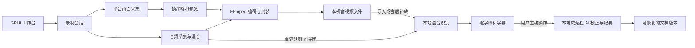

# OpenCap 当前技术方案

记录基线：2026-11-07，源码提交 `f8299c8` 及其后的工作区改动。本文描述当前代码；[低功耗录屏建设方案](low-power-capture-plan.md)与[语音识别改造方案](asr-improvement-plan.md)同时标明已实施部分和后续计划。

## 目标与技术栈

OpenCap 是 Windows / macOS / Linux 的本地录屏、转录、会议纪要工具。需要在保存原媒体的同时支持实时文字、会后转录、说话人分析和用户主动发起的 AI 处理；旧电脑优先保证录制与桌面交互，允许用户用会后处理换取较低的录制负载。

主程序为 Rust 2024 + GPUI Kit 0.7.3；媒体处理使用 FFmpeg / `ffmpeg-next` 9.0.0，语音识别使用 sherpa-onnx 1.13.8 和 ONNX Runtime。Windows 采集为 WGC / D3D11、音频为 WASAPI；macOS 使用 ScreenCaptureKit / CoreAudio；Linux 使用 X11 / PulseAudio，暂不支持 Wayland 屏幕采集。编码器按平台能力选择，软件编码可回退；硬件编码不等于全链路 GPU 零拷贝。



核心代码：

```text
crates/core/       录制配置、媒体帧、时钟、音频处理与会议路径
crates/platform/   Windows、macOS、Linux 原生采集和系统交互
crates/policy/     动态画面帧策略与编码选择
crates/media/      混音、编码、MP4/M4A、预览和性能统计
crates/asr/        模型管理、语音识别、断句校正、转录、AI 与导出
crates/app/        GPUI 界面、后台任务、会议文件与设置
crates/bench/      合成媒体性能对照，不代表真实桌面体验
scripts/           开发、跨平台打包和 Windows 诊断
```

## 录制、10 FPS 与性能边界

用户点击「一键降低占用」后，当前配置将最大 FPS 限制为不超过 10、开启自适应、关闭预览和实时转录、自动编码优先 H.264，并对软件 H.264/H.265 启用较快的编码设置；已设为低于 10 FPS 时不提高它，明确指定的编码器或格式不被覆盖。该按钮改变多个设置，不能将效果全归因于 FPS。10 FPS 表示每秒最多约 10 个采集/编码候选画面，动态画面本身也会不如 30 FPS 流畅；它**不能保证鼠标和整台电脑不卡**。

Windows 在系统支持时向 WGC 请求最小更新间隔，并在 GPU 回读之前限速；旧系统不支持该选项时系统回调仍可能高频发生。原路径复用暂存纹理并同步 Map；默认关闭的「Windows 异步采集（实验）」使用两个暂存槽及非阻塞 Map，仍须复制到 CPU、转换颜色并编码。初始化失败时回退原路径并提示；运行中严重错误则安全结束并保存。macOS 将 FPS 传给 ScreenCaptureKit 的 `minimumFrameInterval`；Linux X11 采集循环按间隔等待。Windows 的 [MinUpdateInterval API](https://learn.microsoft.com/en-us/uwp/api/windows.graphics.capture.graphicscapturesession.minupdateinterval)是否可用由运行时检测，不能假定老机器支持。

录制工作线程现在以音视频、命令及截止时间唤醒，而非每 5 ms 固定轮询；软件编码转换图像在编码器不再持有时复用。软件编码器探测成功结果在进程内有界缓存，硬件探测仍逐次进行。实验 WGC 内仅在有待回读纹理时最多每 5 ms 检查；Windows 驱动和旧设备尚未验证，两个路径都不是 GPU 帧直通。

录制报告保存 CPU、内存、`capture_fps`、编码 `fps`、队列丢帧与部分耗时；`capture_fps` 是应用收到/丢弃的候选帧估算，不是 WGC 内部全部回调或鼠标延迟。`scripts/diagnose-windows.ps1` 在本机采样 OpenCap / DWM 进程和 GPU 引擎。需要 Windows 实机对照 10/15/30 FPS、编码器、分辨率、预览与实时转录，并独立观察鼠标流畅度；采样口径和已验证数据见 [性能排查](performance-review.md)。

当前已有的结果：macOS M1 合成画面编码中位数约改善 6.5%，但首次波动很大且没有真实屏幕采集；Linux ARM64 Xvfb 的 10 FPS 是采集正确性检查；Windows WGC 新代码仅交叉编译和静态检查，**没有第一代 i5 Windows 的实测结果**。之前关闭实时转录与预览后卡顿减轻的反馈不能单独区分两项贡献。

## 语音与 AI 的当前路径

1. 录制混音的 PCM 通过有界通道送独立识别线程；队列积压不应阻塞媒体保存。文件导入使用同一解码/重采样路径。
2. 实时识别可选三个中文 Zipformer；自动模式优先已安装的轻量模型，否则尝试所选文件模型逐句识别。文件转录可选 SenseVoice、Paraformer 轻量或标准，均在本机 CPU 运行。
3. 可选「断句校正」在流式结果后，将该句音频交给所选文件模型重新识别；这是**再听音频的 ASR**，并非文字大模型。队列最多等待两句，连续音频超过 30 秒或队列满时保留流式文字。逐句 VAD 为语音起点补回最多 250 ms 上下文。模型、大小和语言限制见 [本地识别模型](asr-models.md)。
4. 实时二遍会保存逐句流式原稿、二遍稿、模型和实际排队/处理耗时；复核失败或积压保留原稿并标记原因。录制完成后可在逐字稿选择原稿或二遍稿；待补转需通过现有「另存重转」手动处理，尚无逐句自动补转。单独的「AI 校正全文」读取已完成逐字稿和术语，由用户主动调用本机 Ollama 或已配置远程文本服务；AI 全文校正后须先恢复识别原文才能切换逐句版本。
5. 说话人分析是独立的会后本机任务。ASR、说话人、逐字稿、AI 纪要是不同阶段，不应把优化后文本当成可证明原音的事实。

模型在显式下载后缓存在应用配置目录，可用 `OPENCAP_MODEL_DIR` 指定；语音本地识别不上传音视频。远程 AI 校正/纪要只有用户主动发起时发送文本；当前项目尚未接入豆包云端 ASR 或发送音频给多模态精修服务。

## 保存和交互

每场会议有独立目录或原媒体引用，逐字稿 JSON 保存时间、完成状态、缺失区间与模型；TXT、Markdown、SRT、Word 为派生文件。重新使用文件模型转录已有稿件会另存，原媒体和既有稿件不覆盖。逐字稿采用虚拟列表；后台任务显示真实进度和阶段，缺少可测进度时不声称准确剩余时间。

macOS 本机打包使用当前机器的 FFmpeg 动态库，递归打包依赖并按最高最低系统版本设置 Info.plist；临时签名是本地评审用途。它不等于 Windows 安装包或正式发布包，发布依赖与授权要求见 [构建与 Linux](build-and-linux.md) 和 [第三方说明](../THIRD_PARTY.md)。
