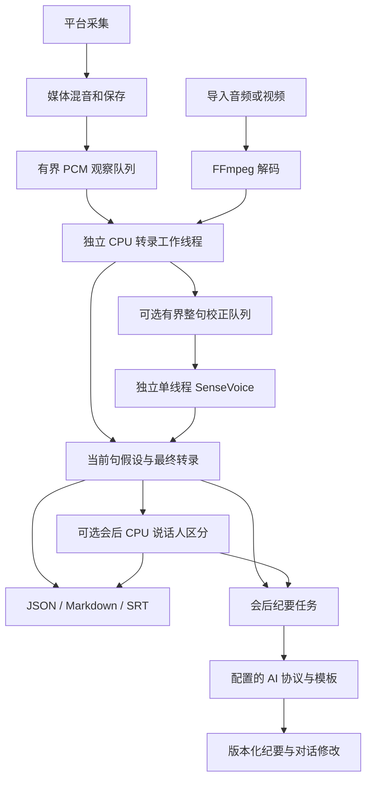

# 一阶段与转录、纪要合并的选型方案

日期：2026-10-12。以中文会议、纯 CPU 推理、Windows / macOS 桌面、本地优先为当前目标。`Meeting_recond` 的 Python 项目保留作结果对照，本轮不修改它。

## 决策

应用业务和任务调度使用 Rust，识别使用 sherpa-onnx 1.13.8 的 Rust / C API。录制、转录和纪要各有独立生命周期；导入文件与实时录制共用转录数据格式。UI 按用户确认迁移到 GPUI Kit 0.7.3，底层采用其匹配的 gpui-pre 0.3.9；GPUI Fast 暂不启用。

| 方案 | 优点 | 取舍与当前用途 |
| --- | --- | --- |
| 流式 Zipformer INT8 | 真流式、CPU、时间戳、beam search 与术语支持 | 当前实时模型：中文字符 transducer 14M 2023-02-23，单线程、4 条候选路径。中间整句可以被替换；中文模型不承诺英文识别。 |
| SenseVoiceSmall INT8 + Silero VAD | 专用语音模型；中、英、粤、日、韩；按语音段识别 | 文件转录默认方案。最长约 15 秒切段；不是逐字真流式。 |
| whisper.cpp / whisper-rs | C++ 推理与 Rust 绑定，多语言 | 保留为未来准确率对照；滚动音频窗口存在重复计算，不作为本轮低占用默认。 |
| Vosk | 小型 CPU 流式模型 | 中文小模型约 42 MB，公开错误率较高，作为极低资源备选。 |
| 现有 R2T2 + MLX | 已有真正流式 Python 原型 | 当前 MLX 性能不是跨平台纯 CPU 证明；保留原项目，不将运行时直接嵌进 Rust GUI。 |

模型仍然是神经网络。Rust 能改善集成与部署，推理速度主要由模型、量化、缓存、线程与输入方式决定。公开短音频速度不等于本机长期会议的耗电和准确率。

## GPUI、GPUI Kit、GPUI Fast

GPUI 是底层窗口与渲染框架。Kit 集成匹配版本的 GPUI 和组件、行为、主题、资源；Fast 是一个可选的底层渲染分支，两者不是同层替代品。

| 方案 | 对项目的收益 | 决策 |
| --- | --- | --- |
| 原 GPUI 0.2.2 | 现有采集窗口接口已验证 | 已迁移，保留平台原生采集边界。 |
| GPUI Kit 0.7.3 | 复用 Button、Input、Markdown、滚动条、主题与 Root；减少自绘交互 | 本轮采用。去掉自绘滚动条和 Div 按钮，保持录制逻辑独立于 UI。 |
| GPUI Kit + GPUI Fast 0.1.7 | 增量渲染、滚动缓存；Kit 提供匹配 feature | 暂不启用。官方仍标实验性，Linux 样例收益不能直接外推本机录制；后续以相同字幕刷新、滚动、空闲场景测量 CPU 和原生窗口互操作后再决定。 |

不能同时链接两套不同 GPUI 核心并在组件间传递 Window / Entity。当前应用只有一个 Kit 入口，由 Kit 固定底层版本。原生 NSView / HWND 的取得、窗口缩略图、菜单栏、录制边框需要继续实机回归。

## 合并后的流程

`core::PcmAudio` 表示带媒体时间戳、采样率和声道数的自有 PCM。媒体输出在 AAC 编码之前复制混合 PCM，`try_send` 队满或关闭都不阻塞保存；关闭转录时不加载识别模型。开启转录后才创建识别工作线程。

录制期间优先使用已安装 streaming 模型；只有 offline 时直接复用 VAD 逐句识别。Streaming 可独立运行，缺少可选校正模型不会阻止实时文字。新配置默认关闭二次校正，已有配置保留；开启后 SenseVoice 在独立校正线程驻留。流式模型先发送当前句原文，停顿后先显示“整句校正中”，下一句继续识别；校正完成后按同一个 id 替换并确认，不追加第二份文本。实时录制和文件试播共用此机制，不再每 5 秒重复解码。校正队列最多等待两句，每句音频最多 30 秒；积压或超长连续发言时直接确认流式原文，不截断语音或阻塞采集。校正模型仍会额外占用 CPU / 内存；关闭“断句校正”恢复单模型低占用模式。文件转录只使用离线模型。文件逐帧解码，使用 libswresample 做 16 kHz 单声道转换，保留滤波器历史并排出尾部。导入文件无需麦克风、录屏权限，也无需重新录制。

实时队列积压时检测时间轴缺口，包括停止时的尾部缺口。录制继续保存；实时稿标记不完整，录制结束后从完整文件启动离线补转，生成替代稿。取消任务保留原媒体和已确认段，取消稿不允许当作完整转录生成纪要。

## 文字修正协议

每段保存 `id / revision / start_ms / end_ms / text / finalized / correcting`。模型返回的是当前整句假设，UI 按 id 和递增 revision 替换，不能将全文当增量追加。

例如：`工` → `公司` → `公司下周开会`，或者后续上下文将先前同音字改写。识别中显示为临时文字；自然停顿、暂停、停止后确认。流式模式取消原来的 20 秒强制断句，连续讲话保留识别器上下文，不在词中间重置；仅文件模型的 VAD 逐句回退仍最长约 15 秒，设置中明确显示两种模式。已确认段不会被迟到的旧事件回滚，也不会由 LLM 暗中改写。

流式识别采用 modified beam search，使不同候选可随新语音重新排序；提供中文术语输入，默认含“录屏、语音转录、会议纪要、实时字幕”。术语是识别偏置，不是字符串强制替换，无法保证所有错字都会被修好。只接受当前中文模型词表能编码的术语；SenseVoice 校正和离线识别不使用该术语配置。说话期间由流式模型直接修订完整当前句，不裁剪成与旧结果相同的字数；可选离线校正只处理已经停顿的整句，并完整替换它。取消或校正线程失效时确认已显示的流式原文。

时间是原媒体时间：跳过静音不能压缩字幕时间，录制暂停遵循一阶段扣除暂停的时钟。当前句段时间戳不承诺逐字强制对齐精度。

## 纪要与持久化

正式 JSON 保存模型与源文件、段落、完整性、取消状态和缺失区间；Markdown 与 SRT 仅导出已确认内容。确认段后后台保存检查点，停止时保存最终状态。界面保留全部段落，通过虚拟列表只布局可见行；当前句修订不会把正在阅读历史的用户拉回底部。

ASR 生成的是逐字稿，AI 会后将逐字稿提炼成会议纪要。识别、上下文校正和说话人分析不依赖语言大模型。语言模型不能当作修复错误事实的依据，尤其不能自行推断地名、人名、数字和已作出的决定。

AI 适配层支持本机 Ollama `/api/chat`、Responses `/v1/responses`、Chat Completions `/v1/chat/completions` 和 Anthropic `/v1/messages`。设置页的 AI 配置位于最上方，转录页上方有直接入口；页面导航修复为设置页优先，因此转录和后台任务不会覆盖设置。服务根地址与模型名持久化到 `ai.json`，密钥只存系统凭据库。远程地址要求 HTTPS，拒绝 URL 中的密钥和重定向，只有用户主动请求才发送逐字稿文字。

普通接口都在工作线程运行，不阻塞 GUI。Responses 另支持显式 `background=true`：轮询 queued/in_progress 状态，只有完整 completed 响应才保存；取消向对应 response ID 的 `/cancel` 发请求。后台响应需要服务端暂存输出，不等同于仅在本机开线程。用户提到的“Asynchronous”名称有歧义，本版同时覆盖 Anthropic 协议和异步任务，未把两者混为一种接口。

长转录按约 6000 字分组整理，再分组归并；最终请求带来源、当前纪要、最近对话和最新要求。标准模板包含会议概况、摘要、议题与讨论、已明确决策、待办表格、风险与未决事项，允许用户提出另一种格式。来源段号和时间、否定和数字、未明确的负责人和期限都应保留；生成内容仍需核对原音频。

“生成”新增完整纪要版本，“按要求修改”带上现有稿与要求新增修订版，“只提问”仅新增对话。`.summary.history.json` 保存版本与对话，`.summary.vNNN.md` 保存历史文档，`.summary.md` 为最新稿；重新导入同名 `.transcript.json` 可以继续修改。服务失败、截断和取消不会覆盖已有纪要。没有模型时 CLI 仅生成单独的 `.excerpt.md`，不假称 AI 纪要。

无需 Agent 框架即可实现模板纪要和反复修改。Word 已由 Rust docx-rs 与 Markdown 解析器直接生成：A4、黑色标题、中文宋体、固定层级、待办表格、重复表头。生成与修改自动保存 `.summary.docx` 及 `.summary.vNNN.docx`，收件人使用 Word/WPS/Pages 即可，无需 Python、Rust 或 AI 运行环境。PDF、特定机关签发版式仍需后续扩展。只有后续需要联网调查、跨文件检索或多步骤工具调用时，才评估 Agent。

## 说话人区分与平台边界

可选会后 diarization 使用同一 sherpa-onnx Rust API：Pyannote segmentation 3.0 INT8（约 1.5 MB）+ 中文 3D-Speaker ERes2Net（约 39.6 MB），分段、声纹特征、聚类都在本机 CPU，默认双线程，可选单线程或四线程。人数为 0 自动估计，或用户指定 1–20；自动聚类阈值默认 0.9，可调 0.1–1.0，越大越易合并；标签按首次出现顺序稳定编号。保留独立 `speaker_turns` 时间段，按交集展示所属说话人。ASR 句子跨多人时展示交替/重叠；缺少逐词时间戳时不强制给整句指派一人，更不编造姓名。

说话人区分在技术上不要求等整场结束：可以边录边提取声纹、增量聚类，临时标签随后合并或修订；但这需要跨窗口匹配和最终复核，短句、重叠发言与 CPU 预算都需单独验证。当前 `OfflineSpeakerDiarization::process` 是读取完整波形后统一分析，尚未实现该增量流程，不能把当前按钮称作实时区分。

此版不在实时字幕阶段运行说话人模型；停止后或导入已有文件时手动分析，再生成带标签的纪要。没有 AEC 的混音、远场、极短发言和重叠讲话仍会误分；指定人数只约束聚类数，不证明区分正确。最长 2 小时是本版完整波形内存缓存的保护边界，2 小时 16 kHz float32 本身约 461 MB，不含模型和聚类；更长会议需分段或设计跨块声纹聚类。

| 平台 | 现状 | 限制与验收 |
| --- | --- | --- |
| macOS | 录制、CPU ASR、会后说话人分析、AI 界面已接入，M1 实机验证 | 源码采集后端 13+；当前捆绑 Homebrew 动态库的包实际要求 26+。录屏/系统音频与麦克风权限独立；开发临时签名更新可能要重新授权当前包。 |
| Windows | 保留 WGC/WASAPI，Kit 与同一 ASR/AI Rust 代码均有 Windows 支持 | 推荐 Windows 11 x64；需匹配 FFmpeg DLL、SDK/Shader Tools。此轮未在 Windows 上构建运行新版，既有 Windows 验收不能替代新版回归。 |
| Linux | sherpa-onnx ASR 引擎可支持 | 本项目录制后端尚未实现，不能宣称全应用支持。 |

## 代码边界与本版入口

- `crates/core`：PCM 和录制配置。
- `crates/media`：混音观察接口，继续拥有视频 / AAC / MP4 保存。
- `crates/asr`：固定模型下载与原子安装、解码 / 重采样、识别线程、修订协议、导出、AI 协议与纪要版本；含独立 `opencap-transcribe` CLI。
- `crates/app/src/transcription.rs`：模型准备、实时 / 文件任务、流式原速试播、术语、纪要和保存入口；采用 Kit 组件。
- `Meeting_recond`：保持原 Python 项目，后续迁移时用同一音频比较结果。

## 验收与后续

先验证真实模型加载、增量事件、修订替换、停止尾部、导入 M4A、字幕与纪要输出；再验证真实录制、暂停继续、队列积压补转、取消和长时资源。单次短 TTS 测试只能证明流程与速度，不能代表多人、远场或真实会议准确率。

后续按需求增加中英模型、实时说话人区分、人工修订、逐字对齐和历史会议列表。麦克风 / 系统声是音源，不是说话人身份；当前混音没有 AEC，扬声器回声和多人重叠讲话需要另外评测。ASR 运行库支持 Linux，但本项目 Linux 录制后端仍未实现。

模型首次使用从官方 HTTPS 地址下载，缓存到应用配置目录的 `models`；之后离线使用。可用 `OPENCAP_MODEL_DIR` 改变缓存位置。具体代码、运行库和权重授权分别记录，发布时不能把引擎许可证当成所有模型权重的许可证。

## 参考

- [GPUI Kit 项目与组件](https://github.com/longbridge/gpui-kit)、[0.7.3 依赖与 feature](https://docs.rs/crate/gpui-kit/0.7.3)
- [GPUI Fast：状态、架构与样例测试](https://github.com/longbridge/gpui-fast)
- [sherpa-onnx Rust API](https://docs.rs/sherpa-onnx/1.13.8/sherpa_onnx/)
- [中文流式 Zipformer](https://k2-fsa.github.io/sherpa/onnx/pretrained_models/online-transducer/zipformer-transducer-models.html)
- [SenseVoice 模型、VAD 和 CPU 实测](https://k2-fsa.github.io/sherpa/onnx/sense-voice/pretrained.html)
- [whisper.cpp](https://github.com/ggml-org/whisper.cpp)、[whisper-rs](https://github.com/tazz4843/whisper-rs)、[Vosk 模型](https://alphacephei.com/vosk/models)
- [R2T2](https://github.com/netease-youdao/Confucius4-R2T2)
- [Ollama Chat](https://docs.ollama.com/api/chat)
- [OpenAI Responses 文本生成](https://developers.openai.com/api/docs/guides/text)、[后台轮询与取消](https://developers.openai.com/api/docs/guides/background)
- [Anthropic Messages](https://platform.claude.com/docs/en/api/messages/create)
- [sherpa-onnx 说话人分析与模型](https://k2-fsa.github.io/sherpa/onnx/speaker-diarization/models.html)、[3D-Speaker](https://github.com/modelscope/3D-Speaker)

## 默认 DeepSeek 与文档生成闭环

默认配置为 OpenAI Responses 协议、DeepSeek 官方 `https://api.deepseek.com`、`deepseek-flash`，因此只需填写 API Key 后保存。另保留 Chat Completions、Anthropic 和 Ollama，提供 DeepSeek 官方与 OpenAI 官方预设；保留已有用户配置，不覆盖自定义服务。DeepSeek 的 Responses 是无状态接口，不支持 `previous_response_id`、服务端 `background` 或 `store`；应用携带当前纪要和近期对话，在自己的后台线程执行，不能把后台线程等同于 DeepSeek 服务端异步响应。

API Key 由系统凭据库加密保护并持久保存，不写入项目/设置 JSON；正常重启同一安装可继续使用，换电脑需重新填写或自行迁移系统凭据。修改服务地址或协议对应另一个凭据条目，不能自动复用不相干服务的 Key。

生成流程为来源分组整理 → 完整会议纪要 → 本机 Word 排版 → 版本与对话保存；不让 AI 编写并执行脚本。`summary.md` 为当前文字稿，`summary.docx` 为可直接交付的文档，`summary.vNNN.*` 为历史版本，`summary.history.json` 保存 AI 回合与版本。录制关联文档与媒体同目录，新导入任务在保存根目录中单独建立会议文件夹；原音视频留在原位置，界面分别显示原文件和产物位置。只提问只保存对话，不重写 Word 或文字稿。

实时说话人区分可采用 VAD 短语音窗口 → 流式声纹特征 → 在线聚类，与实时 ASR 共用时间轴。窗口通常需积累数秒才能提供可用声纹，此处是设计预期而非本机已测延迟。标签应有 provisional/final 状态，允许后续合并、重标，再会后统一复核；新增 CPU/内存和重叠讲话误分需独立评测。本版保持会后 diarization，尚未实现实时说话人标签；ASR 的字幕实时修订与说话人标签修订是两种不同任务。

参考：[DeepSeek Responses 与兼容表](https://api-docs.deepseek.com/guides/responses_api/)、[官方模型与接口](https://api-docs.deepseek.com/api/create-response/)、[sherpa 声纹识别](https://k2-fsa.github.io/sherpa/onnx/speaker-identification/index.html)。

## 2026-10-13：结果入口与文档格式

采用固定主导航：录制、会议文件、设置 / AI；单场会议按逐字稿、AI 纪要、个人笔记分区。会议库扫描录制报告和转写数据，并持久记录已打开的结果路径，避免重启后失去入口。停止录制后跳转会议库；录制页以外仅在录制进行中显示精简控制条。

默认本地转录自动保存、AI 纪要手动生成。列表分别展示“逐字稿已保存/待转录”和“AI 纪要已生成/未生成”。已存在的录制补转沿用录制文件的输出基名，避免同一录制拆成两个结果。外部新导入使用独立会议文件夹与文件前缀；历史 Transcripts 和平铺路径继续兼容。设置始终能切换，任务期间禁止换入另一场会议以避免结果串场。

参考用户提供的三份讯飞导出文档的组织方式：转写保留原话、说话人、时间；纪要提供全文摘要、章节速览、说话人总结，另补明确决策、待办及未决事项；个人笔记单独保存。原始转写 TXT/Word 不调用 LLM，不被 AI 改写覆盖。正式纪要、阅读摘要、行动清单是生成模板，可继续通过自然语言修改。

说话人需先运行本地分析，编号不代表姓名；AI 提示词禁止从编号推测身份，且程序给生成/修改后的纪要附加本地说话人索引（首次发言与累计发言时长），确保模型未主动总结某位发言人时仍能在文档中找到标签。句子跨多人时明确歧义，不伪造逐词对齐。原有纪要不会在分析后静默重写，需要用户重新生成。

笔记输入自动保存为独立 TXT；Word 由用户导出以更新。输出均由应用原生排版，不依赖用户电脑上的 Python。自动 AI 生成、说话人姓名映射、音频逐词对齐、PDF 和整包导出暂不加入本版。
