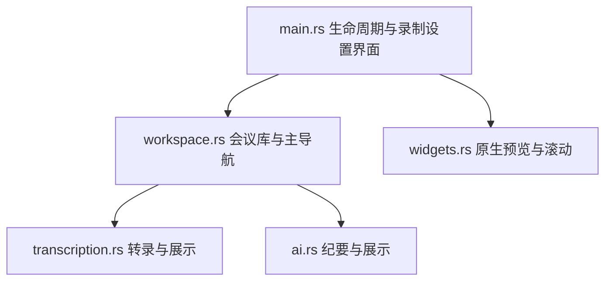
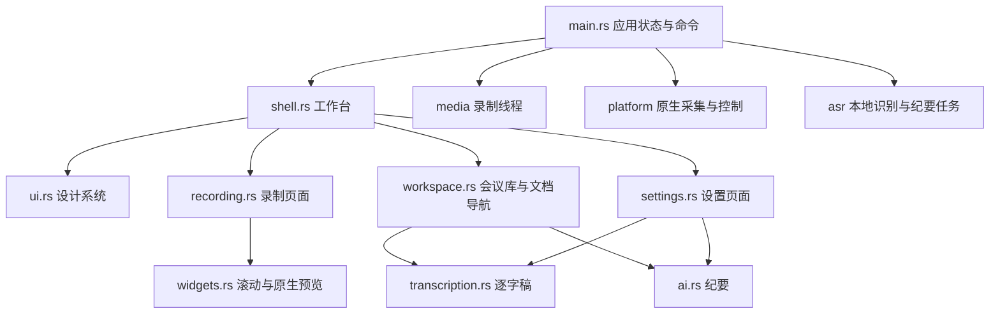

# OpenCap 工作台界面重构

## 目标与约束

围绕录制、转写、纪要和笔记组织桌面工作流。优先保证位置稳定、按钮清晰、主要操作随时可达。沿用 Rust / GPUI Kit 0.7.3、原生采集和现有后台任务，不改变文件格式、密钥存储和录制协议。默认采用浅色工作台，蓝色表示主要操作或选择，红色表示录制和停止。

## 布局评审

| Before | After | Why |
| --- | --- | --- |
| 主导航与状态挤在两排页头 | 固定左侧导航，右侧单行页头 | 导航位置稳定，内容获得更多垂直空间 |
| 设置全部纵向堆叠 | AI、语音转录、录制偏好分组 | 相关选项集中，减少寻找和滚动 |
| 开始、退出、目录和统计混在大底栏 | 底栏保留计时、状态、暂停和开始/停止 | 录制动作始终可见，次要操作回到导航 |
| 所有选中按钮与动作按钮使用相同强调色 | 柔和选中态、实色主按钮、描边次按钮 | 区分“当前选项”和“执行操作” |
| 文档导出、标题和标签分散 | 固定文档页头与标签，内容独立滚动 | 切换长文档时保持上下文 |
| 深色硬编码散落多文件 | ui.rs 统一颜色、按钮、卡片和布局参数 | 表单、Markdown 和自绘区域使用同一主题 |
| 转录只在正文中显示小百分比 | 文档标题下显示蓝色进度条、大号百分比、耗时和剩余时间 | 长任务状态可见，滚动正文也不会丢失 |
| AI 格式只有固定模板，输出混入来源报告 | 主操作下方折叠公司格式、多个历史示例和正文开关 | 先看到生成操作，需要时再设置内容结构 |
| 说话人单线程且自动人数不直观 | 已知人数提示与单 / 双 / 四线程按钮集中在侧栏 | 速度和资源选择可见，减少自动过分拆分 |

## 模块结构

原来 `main.rs` 同时负责录制生命周期和超过一千行界面；`workspace.rs` 混合导航和会议管理。

```text
crates/app/src/
  main.rs           应用状态、生命周期、命令调度、平台事件
  ui.rs             设计 token、语义按钮、卡片、状态、响应式尺寸
  task.rs           任务计时、实际进度和剩余时间估算
  shell.rs          主窗口、导航、固定页头、通知和录制底栏
  recording.rs      目标选择、预览、声音来源、画质、实时文字布局
  settings.rs       设置导航、录制偏好；复用现有 AI/转录设置
  workspace.rs      会议库、文档导航、笔记及本地索引
  transcription.rs  ASR/说话人任务及逐字稿视图
  ai.rs             AI 服务、生成/修改/问答、纪要文档
  widgets.rs        滚动容器和原生目标预览
```

## 依赖与数据流

重构前：



重构后：



旧结构为 `main.rs → workspace/transcription/ai/widgets`，各模块分别硬编码外观；新结构将页面渲染从生命周期中抽出，由 shell 组合页面、ui 提供统一视觉。页面仍直接调用 Recorder 的既有命令，不增加新的状态框架或重复维护录制状态。

## 尺寸与交互

- 默认窗口 1200 × 820；窄窗切换为顶部紧凑导航，录制配置堆叠。
- 宽窗固定 208 px 导航；内容区内边距 28 px，卡片间距 20 px。
- 录制页宽度足够时为预览与 300 px 配置双栏；较窄时改为单栏。
- 选择录制目标时，网格占满整个内容区；选中目标后滚动回顶部并恢复双栏。
- 主按钮高 40 px，普通按钮高 36 px；正文 14 px，辅助文字 12 px。
- 长标题、路径允许截断；按钮组允许换行。停止和暂停固定在底栏。
- 错误和任务反馈在工作台公共位置展示，设置页和会议页也能看见。

## 动效词汇与决策

依据 animation-vocabulary：**Fade in / Fade out** — Element appears or disappears by changing opacity. **Scale** — Make an element bigger or smaller.

本次高频导航和录制操作立即生效。复用组件原生 hover、active、focus 和禁用态反馈；不添加页面入场、弹跳或持续脉冲。GPUI 的既有按钮可访问性与键盘操作保持有效。避免将网页 CSS 动画方案强行迁移到原生渲染器。

## 实施与验证

1. 提取设计系统及页面模块，编译验证依赖。
2. 替换工作台外壳与底栏，验证宽窗及窄窗布局。
3. 重排录制目标、预览、声音和实时文字。
4. 重排会议列表、文档标签、导出和说话人分析。
5. 分组设置并统一表单、Markdown、按钮和状态色。
6. 运行格式、编译、现有工作区测试及实际 UI 检查；记录验证结果。

上述迁移已完成。实测项目和剩余限制见 [验收记录](validation.md#2026-10-13-工作台界面重构)。

## 风险与简化

原生窗口缩略图使用实际 GPUI 布局边界，提取后保持同一预览组件和生命周期。窄窗使用单栏避免固定侧栏挤压内容。Recorder 依旧是单一状态入口，不引入额外事件总线、页面状态副本或 UI 依赖；工作区现有转录/生成互斥关系保留。

参考：[GPUI Kit](https://github.com/longbridge/gpui-kit)、[Emil 设计工程](https://animations.dev/)。ASR 指自动语音识别。主题、窗口尺寸和布局参数在 ui.rs 维护；本次无需新增环境变量。


## 实时历史与文件交互复查（2026-10-17）

| Before | After | Why |
| --- | --- | --- |
| 实时卡只显示最后一句，完整页未完成时也只显示最近 40 段 | 两处共用完整虚拟历史列表，默认跟随，向上翻阅时暂停并可回到最新 | 查历史时不丢内容，不让新字抢走阅读位置 |
| 开始录制后实时文字跑到上方 | 实时文字固定在录制设置下方，底栏录制操作常驻 | 开始按钮不改变阅读位置 |
| 每次修订重新生成多行元数据 | 未变化的行以 Rc 缓存，变化范围一次重测且保留锚点 | 保留已有 Windows 流畅度，避免历史增长造成重复布局 |
| 录音与十多种产物平铺，导入另放 Transcripts | 每场新会议一个文件夹，旧结构兼容 | 复制或定位一场会议更直接 |
| “导出”实际保存后打开 Word | “导出 Word…”选择副本位置，“打开文档”单独操作 | 动作名称对应真实结果 |
| “版本目录”、保存目录与原文件位置含义混杂 | 明确保存根目录、会议文件夹、原文件位置，可复制会议路径 | 导入音频与生成文件不在一起时仍能找到 |

不增加动画，不改采集或识别模型。原文件不自动搬移，导出副本不会覆盖原录音或视频。
## 2026-10-17 会议列表与持续修订

| Before | After | Why |
| --- | --- | --- |
| 开始录制时文字卡片从下方移到上方 | 设置、实时文字的上下顺序固定 | 开始按钮不改变阅读位置 |
| 列表只有生成的文件名和状态 | 可重命名；展示正文摘要、时长、体积 | 打开之前即可判断会议内容 |
| 整篇返回后才显示，仅列最近三轮要求 | 真实流式预览、完整对话、多行修改要求 | 生成过程和迭代上下文可见 |
| 正文只能由 AI 改写 | 手动编辑、同步 Word / Markdown，统一保存版本 | 修改结果能继续参与 AI 修订 |
| 保存密钥后输入框被清空 | 已保存状态、载入密钥、眼睛开关 | 能确认当前服务是否配置 |
