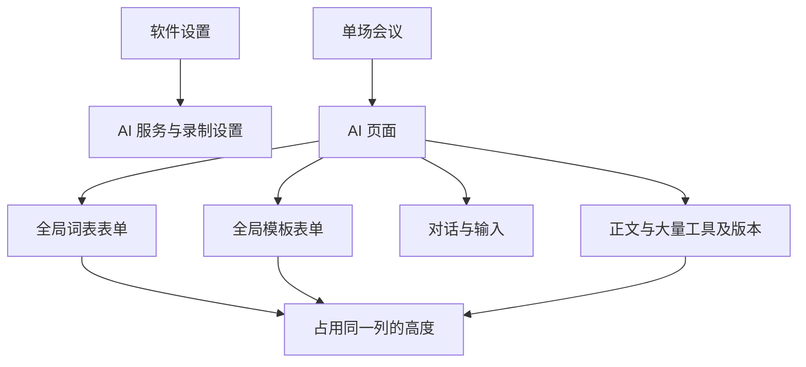
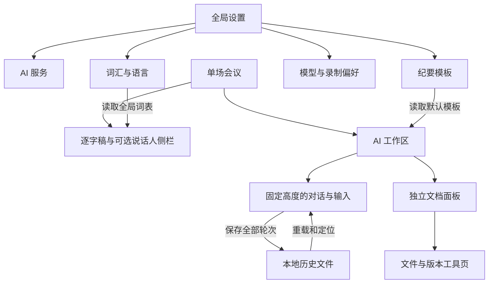

# 工作台布局与功能归属

本次按 code-architecture 的重构流程梳理责任和数据流，按 emil-design-eng 约束内容层级、固定操作区及滚动边界。保留现有 Rust / GPUI 原生桌面技术、后台任务和本地文件协议；Windows、macOS、Linux 使用同一套布局。用户给出的痛点和跨平台约束已足够，直接按以下边界实施。

## 功能归属

| 范围 | 固定入口 | 内容与行为 |
| --- | --- | --- |
| 软件全局 | 设置 → AI 服务 | 服务、模型、系统凭据、推理模式 |
| 软件全局 | 设置 → 词汇与语言 | 专业词和人名、误识别提示、中英语言偏好、流式中文热词；保存一次供所有会议复用 |
| 软件全局 | 设置 → 纪要模板 | 默认文体、正文格式、历史参考文件、是否附来源；会议页仅有当前模板的设置入口 |
| 软件全局 | 设置 → 识别模型 | 模型下载、实时模式和本地推理性能 |
| 软件全局 | 设置 → 录制偏好 | 音画规格、降噪、提示、存储路径及快捷键 |
| 录制中 | 录制工作台 | 画面目标、声音来源、预览、实时文字；开始、暂停、停止固定底部 |
| 单场会议 | 逐字稿 | 搜索、复制、校正全文、恢复原文、导出；说话人分析按需打开，独立侧栏滚动 |
| 单场会议 | AI 对话 | 多轮完整消息、上一轮/下一轮定位、输入框与发送；不内嵌全局配置表单 |
| 单场会议 | AI 右侧文档 | 正文/逐字稿/笔记预览、编辑与导出；文件操作和版本记录在独立工具页，避免推挤正文 |
| 单场会议 | 个人笔记 | 本场笔记编辑、保存与文档同步 |
| 文件库 | 会议文件 | 主题/预览、时长、大小、最近更新；打开、重命名和文件位置 |

## Before / After

| Before | After | Why |
| --- | --- | --- |
| 模板、术语表在聊天上方展开 | 全局设置独立页面 | 表单高度不参与聊天布局 |
| 文档按钮与全部版本竖向累积 | 文档工具页与正文互换 | 导出、编辑、历史不会挤走内容 |
| 聊天只依赖滚动判断轮次 | 明确轮次数，上一轮/下一轮/最新 | 长篇回复也能直接定位旧轮次 |
| 只有文档版本、没有旧对话的文件显示空白 | 显示已保存历史文档，明确来源 | 恢复可用记录，不捏造未保存的用户消息 |
| 逐字稿与分析面板随外层页面长高 | 固定文档高度，文字与说话人侧栏各自滚动 | 控件不改变阅读位置 |

## 重构前

## 重构后

## 组件与数据流

`app/ai.rs` 负责会话任务、凭据及保存；`ai/view.rs` 组合聊天工作区；`ai/artifact.rs` 负责文档、导出和版本工具；`ai/settings.rs` 管理全局配置界面；`ai_chat.rs` 独立维护消息列表和轮次定位；`ai/correction.rs` 继续负责校正任务。`settings.rs` 只做设置路由，`shell.rs` 分配主工作区的可用高度。

模板、词表继续使用全局 `minutes-format.json`，新增默认文体字段兼容旧文件；每场的完整对话仍使用 `summary.history.json`，未完成请求使用 `summary.request.json`。没有数据库、同步服务或新运行时依赖。保存的多轮消息不裁切；仅模型请求上下文按既有预算组装。

## 尺寸、滚动与动效约束

工作区使用外层固定可用高度，主内容 `flex: 1; min-height: 0`。聊天、输入、顶部导航分别分配空间；设置展开、生成开始、版本数量增长不能把输入框顶出窗口。小窗口优先显示完整对话，用明确按钮切换文档；大窗口可拖动双栏分隔线。路径、长错误、参考文件列表在所属区域截断或滚动，不参与主工作区无限增高。

animation-vocabulary 将展开交互称为 **Accordion / Collapse** — “A section smoothly expands and collapses its height to show or hide content.” 本次不在聊天上方使用这种展开布局；高频发送、消息流、轮次定位和标签切换不添加动画。按 Emil 的性能约束，避免给正文高度和滚动位置添加插值动画。

## 迁移与检查

1. 小：将默认文体持久化，兼容现有模板与词表；依赖现有文件协议。
2. 中：移走会议内的全局表单，建立设置页；依赖 1。
3. 中：拆分对话与文档组件，保证输入区固定；依赖 2。
4. 中：补轮次定位和旧文档历史兼容；独立于设置迁移。
5. 中：逐字稿使用受限高度和可选侧栏；复用现有搜索/说话人组件。
6. 中：用真实鼠标验证短窗口、长回复、切换工具和设置返回；依赖 3–5。
7. 中：本地测试、静态检查并更新原位置的 macOS 应用包；依赖 6。不推送、不触发云端构建。

风险：早期没有写入文件的对话无法恢复，只能显示实际保存的文档版本；长 Markdown 的动态行高需要实测；本机原生依赖决定安装包系统下限。验证使用隔离目录，不修改用户会议和凭据。保持已有原生组件和 JSON 文件，避免为单一布局新增路由框架或状态管理层。

配置参考：`ai.json` 保存不含密钥的服务信息；密钥在系统凭据库；`settings.json` 保存语言、录制和转录偏好；会议目录保存媒体和派生文档。术语：“轮次”为一次用户要求与对应回复；“文档面板”为同一场会议的输出预览。实现依据均为仓库中的组件与本地 GPUI 源码；操作说明见 [README](../README.md)。

## 完成后的验证记录

- 94 项工作区测试通过；原有 3 项外部环境测试保持忽略；全目标、全特性严格 Clippy 与格式检查通过。
- 用隔离会议与回环 AI 服务测试真实原生窗口：620×480 下鼠标、Enter 先后提交两轮意见，最终保存 6 轮和 6 个版本，前四轮记录保持原样；第二个请求同时包含上一轮意见和全局词表。
- 实机检查上一轮、下一轮、最新、长文滚动、全局设置往返、文件位置浮层、历史版本预览、文档工具页、逐字稿与说话人侧栏。短窗口中历史与输入框同时可见；宽窗口文档和聊天填满各自栏宽。首份检查暴露的短窗口零高度和宽窗口空隙均已修正。
- `ai/checks.rs` 的开发检查补上 620×480 尺寸与发送按钮仍在视口内的断言，防止后续功能再次挤掉内容。
- 已完成本地优化 Release 编译，并在原位置更新 `release/OpenCap.app`，签名与依赖检查通过，正式包已启动验收；没有新增带后缀的应用副本，也没有推送或触发云端构建。
- 证据位于 `target/verify/workspace-layout-{tests,clippy,release,package-release}.log` 和 `target/verify/workspace-layout-ui/verification.json`。回环服务和验收进程已关闭。Windows / Linux 尚未在本轮实机运行，跨平台公共界面代码已通过本地编译审查。
