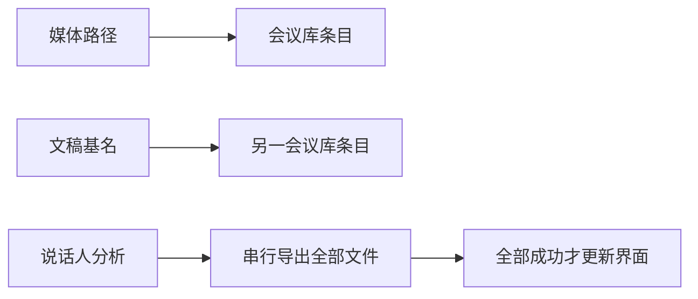
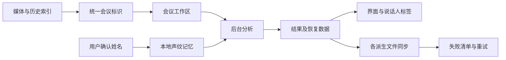

# 会议工作区与结果持久化

本次沿用 Rust / GPUI 原生应用、JSON 文件与已有本地语音模型。会议录制、逐字稿、说话人、AI 对话仍以同一个会议文件前缀关联，无须引入数据库。用户要求包括：会议库去重、分析结果及时展示并同步、逐字稿检索和选择、对话与产出分栏、可选择记住的本地声纹，以及更自然的麦克风降噪。

## 数据与界面边界

现有路径同时承担媒体位置和会议标识，扫描得到的扩展名为空路径与记忆的媒体路径不同，导致重复。统一会议标识时保留真实媒体路径；旧索引只做归并，不移动或删除任何录音、文档。转录 JSON 是恢复数据，Word、TXT、SRT 是派生产物。计算结果与导出成功分离：结果先进入界面与恢复数据，个别导出失败明确提示并可重试。写文件使用同目录临时文件和替换，替换失败保留旧文件。

此前：

调整后：

## 组件与持久化

- `workspace.rs`：扫描与归并会议，兼容相对/绝对路径、媒体与前缀两种旧索引；始终保留可用的媒体位置。
- `transcript.rs`：说话人姓名、匹配来源、文件同步警告及各格式导出；旧 JSON 使用默认字段保持可读。
- `speaker_memory.rs`：复用 ERes2Net 提取非重叠发言声纹；本地 JSON 保存用户明确命名的声音，不保存新录音。后续会议只匹配足够可靠且无歧义的候选，未匹配者继续使用本场编号。支持删除记忆与修改姓名，修改不会凭空合并两人。
- `transcript_view.rs`：保持虚拟列表，搜索结果按时间定位，文字使用原生可选择文本组件。查找与复制不改动逐字稿原文，实时修订保留阅读位置。
- `ai.rs` / `ai_chat.rs`：左侧持续对话、底部输入，右侧可收起、可调整宽度的文档区；生成、停止、修订、历史与手动编辑继续使用现有 API。窄窗口只展示一个主面板并可切换。
- 文本产物优先使用应用内预览。TXT 读取失败在应用内显示错误；Windows 外部打开在子进程中调用系统文件关联，主界面不等待文件处理器。
- `denoise.rs`：保留连续采样、频谱降噪与限制幅度；使用更温和的扩展、保持时间与平滑释放，避免把停顿变成突然的数字静音，限制自动增益在噪声处追涨。

声纹记忆是用户命名后的相似度匹配，不是身份证明。模型、采样率、维度和音频质量必须匹配；混叠发言不用于登记。JSON 记录模型版本与样本长度，匹配失败不覆写手工姓名。首次命名可以只用于本场，也可以由用户主动保存到本机记忆。已生成 AI 正文不会静默重写，新的分析信息供下一轮对话使用。

## 实施顺序与验证

1. 先修复会议索引与结果同步，覆盖旧索引归并、目录别名、文档被占用/不可写时的结果保留。
2. 给逐字稿增加原生选区和 Unicode 搜索，验证中文匹配、上下定位、实时增量与历史滚动。
3. 分离 AI 主对话与文档产出，验证抽屉开合、宽度拖动、窄窗口、流式生成与版本切换。
4. 接入主动登记和自动匹配的本地声纹，验证不同人、相近候选、模型不匹配、短音频、删除记忆和文档重新载入。
5. 用连续底噪加发言的确定性音频测量启闭处的增益变化与声母保留，验证不同设备分包下波形一致。
6. 最后运行工作区回归、严格 Clippy 和界面验证；跨平台尚未实测的行为单独说明，不用本机测试替代 Windows 崩溃复现。

## 本次验证记录

常规工作区回归通过 81 项，严格 Clippy（全部目标、全部功能）通过。声纹的额外模型集成验证使用原有合成录音，提取 4 组 512 维声纹，完成主动登记与再次匹配；测试目录随测试清理。该验证检查管线与隔离存储，不代表真实不同设备上的识人准确率。

macOS 原生窗口实际验证了中文搜索高亮、拖选后复制原文、TXT 预览与复制、620 像素宽窗口的对话/文档切换。分栏拖动后右侧控件横坐标从 913 移至 791，确认使用实际可调整面板。Windows 新增的文件打开模块已单独通过 MSVC 目标编译检查；尚未在 Windows 实机复现并回测整个应用退出，也未实测 Linux 新交互。

所有预览和模拟请求使用 `target/verify/workspace-reliability` 内的合成材料与隔离配置，未创建新的应用副本、下载语音模型或修改原录音。
