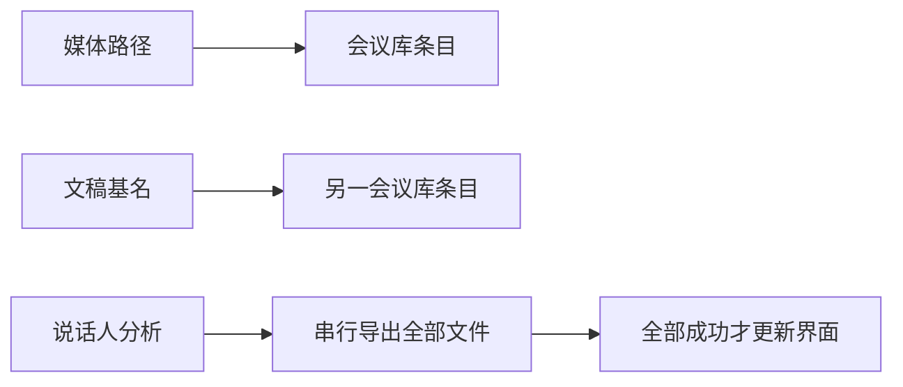
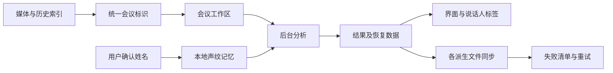

# 会议工作区与结果持久化

本次沿用 Rust / GPUI 原生应用、JSON 文件与已有本地语音模型。会议录制、逐字稿、说话人、AI 对话仍以同一个会议文件前缀关联，无须引入数据库。用户要求包括：会议库去重、分析结果及时展示并同步、逐字稿检索和选择、对话与产出分栏、可选择记住的本地声纹，以及更自然的麦克风降噪。

## 数据与界面边界

现有路径同时承担媒体位置和会议标识，扫描得到的扩展名为空路径与记忆的媒体路径不同，导致重复。统一会议标识时保留真实媒体路径；旧索引只做归并，不移动或删除任何录音、文档。转录 JSON 是恢复数据，Word、TXT、SRT 是派生产物。计算结果与导出成功分离：结果先进入界面与恢复数据，个别导出失败明确提示并可重试。写文件使用同目录临时文件和替换，替换失败保留旧文件。

此前：

调整后：

## 组件与持久化

- `workspace.rs`：扫描与归并会议，兼容相对/绝对路径、媒体与前缀两种旧索引；始终保留可用的媒体位置。
- `transcript.rs`：说话人姓名、匹配来源、文件同步警告及各格式导出；旧 JSON 使用默认字段保持可读。
- `speaker_memory.rs`：复用 ERes2Net 提取非重叠发言声纹；本地 JSON 保存用户明确命名的声音，不保存新录音。后续会议只匹配足够可靠且无歧义的候选，未匹配者继续使用本场编号。支持删除记忆与修改姓名，修改不会凭空合并两人。
- `transcript_view.rs`：保持虚拟列表，搜索结果按时间定位，文字使用原生可选择文本组件。查找与复制不改动逐字稿原文，实时修订保留阅读位置。
- `ai.rs` / `ai_chat.rs`：左侧持续对话、底部输入，右侧可收起、可调整宽度的文档区；生成、停止、修订、历史与手动编辑继续使用现有 API。窄窗口只展示一个主面板并可切换。
- 文本产物优先使用应用内预览。TXT 读取失败在应用内显示错误；Windows 外部打开在子进程中调用系统文件关联，主界面不等待文件处理器。
- `denoise.rs`：保留连续采样、频谱降噪与限制幅度；使用更温和的扩展、保持时间与平滑释放，避免把停顿变成突然的数字静音，限制自动增益在噪声处追涨。

声纹记忆是用户命名后的相似度匹配，不是身份证明。模型、采样率、维度和音频质量必须匹配；混叠发言不用于登记。JSON 记录模型版本与样本长度，匹配失败不覆写手工姓名。首次命名可以只用于本场，也可以由用户主动保存到本机记忆。已生成 AI 正文不会静默重写，新的分析信息供下一轮对话使用。

## 实施顺序与验证

1. 先修复会议索引与结果同步，覆盖旧索引归并、目录别名、文档被占用/不可写时的结果保留。
2. 给逐字稿增加原生选区和 Unicode 搜索，验证中文匹配、上下定位、实时增量与历史滚动。
3. 分离 AI 主对话与文档产出，验证抽屉开合、宽度拖动、窄窗口、流式生成与版本切换。
4. 接入主动登记和自动匹配的本地声纹，验证不同人、相近候选、模型不匹配、短音频、删除记忆和文档重新载入。
5. 用连续底噪加发言的确定性音频测量启闭处的增益变化与声母保留，验证不同设备分包下波形一致。
6. 最后运行工作区回归、严格 Clippy 和界面验证；跨平台尚未实测的行为单独说明，不用本机测试替代 Windows 崩溃复现。

## 本次验证记录

常规工作区回归通过 81 项，严格 Clippy（全部目标、全部功能）通过。声纹的额外模型集成验证使用原有合成录音，提取 4 组 512 维声纹，完成主动登记与再次匹配；测试目录随测试清理。该验证检查管线与隔离存储，不代表真实不同设备上的识人准确率。

macOS 原生窗口实际验证了中文搜索高亮、拖选后复制原文、TXT 预览与复制、620 像素宽窗口的对话/文档切换。分栏拖动后右侧控件横坐标从 913 移至 791，确认使用实际可调整面板。Windows 新增的文件打开模块已单独通过 MSVC 目标编译检查；尚未在 Windows 实机复现并回测整个应用退出，也未实测 Linux 新交互。

所有预览和模拟请求使用 `target/verify/workspace-reliability` 内的合成材料与隔离配置，未创建新的应用副本、下载语音模型或修改原录音。

## 关键词、滚动与下载的后续修正

`MinutesFormat.terminology` 在已有 `minutes-format.json` 保存词表，兼容旧配置。支持单列标准词和“误词 => 正词”；长稿提取、合并与最终生成/修订均收到同一份词表。已有正文通过原来的版本保存流程修订，继续同步 Word、Markdown 和对话历史。界面将词表放在 AI 对话顶部“关键词”中，可保存后跨会议使用。

`TranscriptView` 在列表处理滚轮后截断冒泡，实时文字与逐字稿共用此行为；TXT 预览也截断外层滚动。移除逐段重复按钮，保留选中文字和全文复制。真实窗口使用 5,000 段合成文字，分别在实时文字和逐字稿派发上下滚轮：从第 10 段到第 0 段、继续向上和再向下，外层页面偏移均不变。620 / 1200 像素宽度下每次只请求 5–13 行布局；该数字不是 FPS。

`speaker_models.rs` 独立处理两份模型的下载、缓存和校验。优先使用发布者的固定 Hugging Face 版本，GitHub 作为备用；每个文件校验 SHA256 后单独安装，完整缓存可复用。连接超时 10 秒，读取无数据超时 15 秒，每个请求最长 5 分钟；取消在等待网络时也会响应。请求启用系统代理。状态显示来源、传输大小、百分比（服务提供总大小时）和速度，传输完毕明确进入校验阶段。

本次工作区通过 86 项测试及严格 Clippy。新增覆盖词表兼容与持久化、长稿多阶段请求和修订文档保存、损坏下载换源、压缩包提取及无响应下载取消。使用已有的 0.9 分钟四人合成音频验证真实说话人管线，直接复用已安装模型、指定 4 人并完成分组与文件导出。预览与测试数据均在 `target/verify/keyword-scroll`；未向外部 AI 发送资料，未创建新应用副本。Windows 系统代理和实际网络环境仍需实机验收。

## 全文语义校正与对话发送

全文校正在 `asr/correction.rs` 独立实现，复用已有 AI 协议客户端，不经过纪要的要点提取流程。每批都携带完整会议上下文，目标输出按约 3000 字、最多 60 段划分，以减少服务端输出截断。所有批次的 JSON 段号、顺序、数量和文字长度通过校验后，才发布新的转写 JSON，并同步派生文档。失败或取消不会发布半份校正稿。`Transcript.correction` 保存模型、时间、本次修改段数和首份识别原文；恢复原文仍保留现有时间戳、说话人和媒体路径。无需数据库，也不另造会议条目。大模型的上下文容量仍需容纳整场转写；程序不会在校正时偷偷提取摘要或丢弃尾部。

应用侧全文校正与恢复任务放在 `app/ai/correction.rs`，和纪要的版本历史分别处理。校正不自动改写已确认的纪要，用户后续发送修改要求时使用最新转写。文档显示校正来源，TXT、Markdown、Word 均带校正标记。

对话保留每轮完整回复和流式正文，回复下方提供对应文档版本入口，替代只显示版本按钮的行为。新发送跟随最新，阅读历史时流式更新不夺走滚动位置；聊天 Markdown 不再建立第二层滚动。输入在真正启动请求时按提交快照清空，完成时不再无条件清空。未完成请求保存到同会议的 `summary.request.json`，可在重启后重试；完成时删除，若删除失败，重新载入也不会重复显示已完成轮次。

`RecordingConfig.transcription_language` 缺省为中文提示，同时保留英文术语；可切换英文或五语自动判断。设置传至文件识别和实时整句校正，CLI 对应 `--language zh|en|auto`。中文流式解码器自身仍是中文模型，语言提示不等于强制字符过滤。正文校对默认按中文和英文理解，对无法确认的语音误识别保留待核实标记。

本地验证：91 项工作区测试通过（原有 3 项外部环境测试保持忽略），严格 Clippy 通过。四种 AI 协议均验证完整上下文进入每一批请求、返回结果和原文保存、重载恢复，以及失败/取消不覆盖原文。真实 GPUI 窗口用 Enter 和鼠标分别发送两轮修改，确认请求包含输入意见、完成前显示流式正文；304 条消息在 1200 / 700 像素宽度下均能从末轮滚回第一轮，外层偏移不变。中英文测试音频通过本地 SenseVoice 解码，英文在 `zh` / `en` 提示下均保留 API 英文内容；这些样本不能代表总体识别准确率。日志在 `target/verify/ai-correction-{tests,clippy}.log`，界面检查在 `target/verify/ai-chat-ui/chat-check.json`。本次未触发云端构建。
